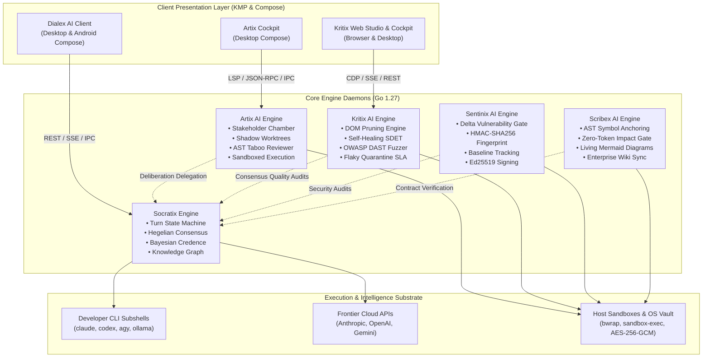

# Dialex Suite Knowledge Base & Technical Wiki

Welcome to the comprehensive technical documentation wiki for the **Dialex Suite**, engineered by **Keltstone Systems**. Dialex Suite is an enterprise-grade ecosystem of autonomous deliberation, software engineering, and quality assurance engines designed on a shared principle: **AI models must adversarially disagree and verify their claims deterministically before human engineers trust their output.**

---

## 🏛️ Architecture Map & Wiki Navigation

The Dialex Suite comprises four specialized, sovereign engines that can run independently or interoperate through zero-trust RPC and streaming event meshes:

---

## 📖 Wiki Table of Contents

### 1. [System Suite Architecture](suite-architecture/01_ECOSYSTEM_OVERVIEW.md)
*High-level system design, multi-engine topology, zero-cloud security model, and buyer's technical evaluation.*
- [01. Ecosystem Architecture & System Design](suite-architecture/01_ECOSYSTEM_OVERVIEW.md)
- [02. Distributed Topology & Mesh Networking](suite-architecture/02_DISTRIBUTED_TOPOLOGY_AND_NETWORKING.md)
- [03. Sovereign Vault & Zero-Cloud Security](suite-architecture/03_SECURITY_VAULT_AND_SOVEREIGNTY.md)
- [04. Prospective Users & Technical Evaluation](suite-architecture/04_PROSPECTIVE_USERS_TECHNICAL_EVALUATION.md)

---

### 2. [Socratix Engine Wiki](socratix-engine/01_CONCEPTUAL_FOUNDATION.md)
*The core deliberation, Hegelian consensus, and Socratic reasoning daemon.*
- [01. Conceptual Foundation & Epistemology](socratix-engine/01_CONCEPTUAL_FOUNDATION.md)  
  *The epistemological failure of single LLMs, Hegelian dialectics (Thesis-Antithesis-Synthesis), and anti-sycophancy design.*
- [02. Core Technical Architecture](socratix-engine/02_CORE_TECHNICAL_ARCHITECTURE.md)  
  *Turn State Machine, Paraconsistent Contradiction Detector, Bayesian Credence Ledger, SQLite Knowledge Graph, and Dynamic RAG.*
- [03. User Guide & Operational Playbooks](socratix-engine/03_USER_GUIDE_AND_OPERATIONS.md)  
  *Daemon operations, CLI flags, 1-on-1 Socratic interviews (`/grill-me`), Dialex-Bench-10 benchmarking, and quickstart modes.*
- [04. Developer Guide & API Reference](socratix-engine/04_DEVELOPER_GUIDE_AND_API_REFERENCE.md)  
  *Go package breakdown, REST & SSE protocol schemas, custom model runners, 8-layer persona compiler, and test harnesses.*

---

### 3. [Dialex AI Client Wiki](dialex-ai/01_CONCEPTUAL_FOUNDATION.md)
*Cross-platform desktop and mobile visual deliberation client (KMP & Compose).*
- [01. Conceptual Foundation & Visual Deliberation](dialex-ai/01_CONCEPTUAL_FOUNDATION.md)  
  *Synthetic Advisory Boards, real-time epistemic steering, cognitive diversity, and decision artifact synthesis.*
- [02. Core Technical Architecture](dialex-ai/02_CORE_TECHNICAL_ARCHITECTURE.md)  
  *Kotlin Multiplatform Clean Architecture, Unidirectional MVI (`Contract.kt`), Kolt token design system, and AES-256 Vault.*
- [03. User Guide & Deliberation Manual](dialex-ai/03_USER_GUIDE_AND_WORKFLOWS.md)  
  *Desktop and Android user manual, Council configuration, live human interrupts, Socratic mode, and exporting ADRs/Memos.*
- [04. Developer Guide & Build Pipelines](dialex-ai/04_DEVELOPER_GUIDE_AND_BUILD_PIPELINE.md)  
  *Gradle composite build (`Kolt`), MVI state contract engineering, packaging native installers (DMG, MSI, APK), and unit testing.*

---

### 4. [Artix AI Platform Wiki](artix-ai/01_CONCEPTUAL_FOUNDATION.md)
*Autonomous software engineering, spec deliberation, and sandboxed patch convergence.*
- [01. Conceptual Foundation: The Dialectic Engineering Lab](artix-ai/01_CONCEPTUAL_FOUNDATION.md)  
  *Solving the "Solo Sycophant Problem", decoupling Chamber 1 (Planning) from Chamber 2 (Lab), and zero-disruption coding.*
- [02. Core Technical Architecture](artix-ai/02_CORE_TECHNICAL_ARCHITECTURE.md)  
  *Shadow Git Worktrees (`git worktree`), Taboo Space AST Reviewer, Network-denied sandbox (`bwrap`/`sandbox-exec`), and LSP 3.17.*
- [03. User Guide & Cockpit Manual](artix-ai/03_USER_GUIDE_AND_COCKPIT.md)  
  *Interactive CLI REPL, Compose Desktop Cockpit, IDE integrations (VS Code, IntelliJ, Zed), and PR review synthesis.*
- [04. Developer Guide & Extensibility](artix-ai/04_DEVELOPER_GUIDE_AND_EXTENSIBILITY.md)  
  *Go package architecture, language driver allowlists, webhook daemon (`artixd`), dynamic steering sync, and adversarial security tests.*

---

### 5. [Kritix AI Platform Wiki](kritix-ai/01_CONCEPTUAL_FOUNDATION.md)
*Autonomous enterprise end-to-end testing, token-optimized SDET, and security QA.*
- [01. Conceptual Foundation: Deterministic Token Optimization](kritix-ai/01_CONCEPTUAL_FOUNDATION.md)  
  *Reversing the brute-force DOM token drain, zero-token native Go algorithms, and enterprise reliability guarantees.*
- [02. Core Technical Architecture](kritix-ai/02_CORE_TECHNICAL_ARCHITECTURE.md)  
  *Semantic DOM Pruner (95% token savings), CDP virtual driver, Multi-factor self-healing locators, and DAG workflow pipelines.*
- [03. User Guide & Testing Workflows](kritix-ai/03_USER_GUIDE_AND_STUDIO.md)  
  *Web Studio demonstration recorder, Compose Desktop Cockpit, OWASP Top 10 DAST fuzzing, k6 performance audits, and quarantine SLAs.*
- [04. Developer Guide & Enterprise Administration](kritix-ai/04_DEVELOPER_GUIDE_AND_ENTERPRISE.md)  
  *Package breakdown, RBAC cryptographic tokens, tamper-evident audit logs (`KRITIX_AUDIT_LOG`), Playwright repro export, and CI/CD.*

---

### 6.  [Sentinix AI Platform Wiki](sentinix-ai/01_CONCEPTUAL_FOUNDATION.md)
*Continuous security review, PR gating, baseline tracking, and vulnerability posture engine.*
- [01. Conceptual Foundation & Defensive Principles](sentinix-ai/01_CONCEPTUAL_FOUNDATION.md)  
  *Change-delta paradigm (head vs. base), content-based fingerprinting, epistemic coverage statements, and separation of duties.*
- [02. Core Technical Architecture & Security Model](sentinix-ai/02_CORE_TECHNICAL_ARCHITECTURE.md)  
  *Component topology, multi-engine normalization, database-agnostic persistence (PostgreSQL & SQLite WAL), container sandboxing, and Ed25519 signing.*
- [03. User Guide & Operational Manual](sentinix-ai/03_USER_GUIDE_AND_OPERATIONS.md)  
  *Complete CLI reference (`scan`, `surface`, `packs`), baseline workflows, rule pack authoring, web dashboard operations, and audit reporting.*
- [04. Complete Setup Scenarios & Deployment Guide](sentinix-ai/04_SETUP_SCENARIOS_AND_DEPLOYMENT_GUIDE.md)  
  *Step-by-step guides for Serverless GitHub Actions, Serverless GitLab CI, Linux VM with Caddy, Production Docker Compose, and Enterprise Kubernetes (Helm).*

---

### 7. [Scribex AI Platform Wiki](scribex-ai/01_CONCEPTUAL_FOUNDATION.md)
*Living documentation, AST-grounded code synchronization, enterprise wiki federation, and compliance evidence engine.*
- [01. Conceptual Foundation & Epistemology](scribex-ai/01_CONCEPTUAL_FOUNDATION.md)  
  *Documentation decay dynamics ("documentation graveyards"), AST grounding, zero-token impact gate, surgical skeletons (<40 tokens), and epistemic safety.*
- [02. Core Technical Architecture & Engine Internals](scribex-ai/02_CORE_TECHNICAL_ARCHITECTURE.md)  
  *Polyglot symbol scanners (Go AST, Kotlin, Java, TS, Python), 16-hex anchor engine, living Mermaid diagram synthesis, hardened HTTPX transport, RBAC daemon, and MCP protocol.*
- [03. User Guide & CLI Reference Manual](scribex-ai/03_USER_GUIDE_AND_CLI_REFERENCE.md)  
  *Exhaustive CLI reference (`init`, `check`, `sync`, `diagram`, `scavenge`, `comment`, `confluence`, `jira`, `trace`, `serve`, `config`, `secrets`, `ci`, `mcp`, `wiki`), configuration schemas, and daily playbooks.*
- [04. Master Platform Integration & Setup Guide](scribex-ai/04_SETUP_SCENARIOS_AND_PLATFORMS_GUIDE.md)  
  *Overview integration matrix and links to dedicated platform deep-dive guides:*
  - [Atlassian Confluence Setup Guide](scribex-ai/platforms/confluence.md) *(Draft-only sync, API tokens, manifest mapping, storage-format XHTML)*
  - [Atlassian Jira Setup Guide](scribex-ai/platforms/jira.md) *(Automated acceptance criteria reality-check, breaking changes / scope creep detection)*
  - [GitHub Actions & PR Bot Guide](scribex-ai/platforms/github.md) *(Scaffolded PR check, comment bot, post-merge docs sync PR, weekly scavenge, GHES)*
  - [GitLab CI/CD Integration Guide](scribex-ai/platforms/gitlab.md) *(Merge request gating, protected/masked variables, self-hosted GitLab)*
  - [In-Repo Markdown & Wikis Guide](scribex-ai/platforms/markdown_and_wikis.md) *(Anchors syntax, Mermaid diagrams, [[Wikilinks]], backlinks, GitHub Wiki)*
  - [Notion Workspaces via MCP Guide](scribex-ai/platforms/notion.md) *(Notion internal integration, `@notionhq/notion-mcp-server`, agentic workflows)*
  - [Compliance & Audit Evidence Guide](scribex-ai/platforms/compliance_and_audit.md) *(SOC2 / ISO 27001 trace matrix, formula-injection defense, JSON sidecar)*
  - [Central Governance Dashboard Guide](scribex-ai/platforms/governance_dashboard.md) *(Multi-repo `scribex serve` daemon, SHA-256 RBAC, Caddy/Nginx TLS)*

---

## 🚀 Quick Navigation by Persona

| If You Are A... | Start Here | Primary Documents to Consult |
|---|---|---|
| **Staff / Principal Architect** | [Socratix Epistemology](socratix-engine/01_CONCEPTUAL_FOUNDATION.md) | [Socratix Architecture](socratix-engine/02_CORE_TECHNICAL_ARCHITECTURE.md), [Artix Architecture](artix-ai/02_CORE_TECHNICAL_ARCHITECTURE.md) |
| **CTO / VP of Engineering** | [Suite Overview](suite-architecture/01_ECOSYSTEM_OVERVIEW.md) | [Prospective Evaluation](suite-architecture/04_PROSPECTIVE_USERS_TECHNICAL_EVALUATION.md), [Security Vault](suite-architecture/03_SECURITY_VAULT_AND_SOVEREIGNTY.md) |
| **Software Engineer / Contributor** | [Artix Cockpit Manual](artix-ai/03_USER_GUIDE_AND_COCKPIT.md) | [Artix Dev Guide](artix-ai/04_DEVELOPER_GUIDE_AND_EXTENSIBILITY.md), [Dialex Dev Guide](dialex-ai/04_DEVELOPER_GUIDE_AND_BUILD_PIPELINE.md) |
| **QA Lead / SDET Architect** | [Kritix Overview](kritix-ai/01_CONCEPTUAL_FOUNDATION.md) | [Kritix Architecture](kritix-ai/02_CORE_TECHNICAL_ARCHITECTURE.md), [Kritix User Guide](kritix-ai/03_USER_GUIDE_AND_STUDIO.md) |
| **DevSecOps / AppSec Lead** | [Sentinix Conceptual Foundation](sentinix-ai/01_CONCEPTUAL_FOUNDATION.md) | [Sentinix Setup Scenarios](sentinix-ai/04_SETUP_SCENARIOS_AND_DEPLOYMENT_GUIDE.md), [Sentinix Architecture](sentinix-ai/02_CORE_TECHNICAL_ARCHITECTURE.md) |
| **Technical Writer / Doc Lead** | [Scribex Conceptual Foundation](scribex-ai/01_CONCEPTUAL_FOUNDATION.md) | [Scribex CLI Reference](scribex-ai/03_USER_GUIDE_AND_CLI_REFERENCE.md), [Platform Guides](scribex-ai/04_SETUP_SCENARIOS_AND_PLATFORMS_GUIDE.md) |
| **Security & Compliance Auditor** | [Security Vault](suite-architecture/03_SECURITY_VAULT_AND_SOVEREIGNTY.md) | [Compliance Evidence Guide](scribex-ai/platforms/compliance_and_audit.md), [Sentinix User Guide](sentinix-ai/03_USER_GUIDE_AND_OPERATIONS.md) |

---
*Maintained by Keltstone Systems. Licensed under the PolyForm Noncommercial License 1.0.0.*
