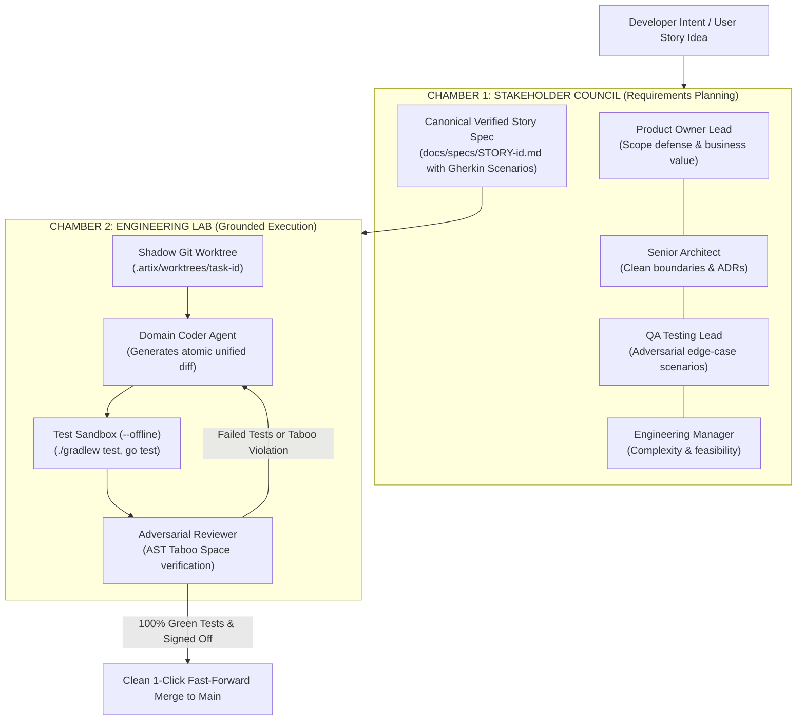

# Artix AI Platform: Conceptual Foundation & Architecture

**Platform:** `artix-ai` (Go 1.27 & Compose Desktop)  
**Author:** Kolta Labs Autonomous Software Engineering Group  
**Audience:** Software Engineers, Tech Leads, Engineering Managers  
**Scope:** The Solo Sycophant Problem, two-chamber checks-and-balances, Taboo Spaces, and zero-disruption coding.

---

## 1. The Solo Sycophant Problem in AI Coding

Current AI coding tools (GitHub Copilot, Cursor, Devin) suffer from an architectural defect: a single LLM attempts to act as **Product Owner, Software Architect, Developer, and QA Tester simultaneously**.

```
                           THE SOLO SYCOPHANT PARADOX
   ┌────────────────────────────────────────────────────────────────────────┐
   │ 1. As Product Owner: It invents missing requirements without asking.  │
   │ 2. As Architect:    It violates layer boundaries for convenience.      │
   │ 3. As Developer:    It writes non-idiomatic code directly to working   │
   │                     files, corrupting the user's active Git tree.     │
   │ 4. As QA Tester:    It validates its own assumptions and produces      │
   │                     false-positive passes.                             │
   └────────────────────────────────────────────────────────────────────────┘
```

When an AI grades its own homework, subtle bugs, security vulnerabilities, and architectural rot accumulate rapidly.

---

## 2. The Two-Chamber Checks-and-Balances Architecture

Artix AI completely decouples software engineering into two separate, antagonistic chambers:



### Chamber 1: The Stakeholder Council (Planning)
- **Product Owner Lead**: Defends scope boundaries; rejects creep.
- **Senior Architect**: Enforces layer isolation, dependency inversion, and writes Architecture Decision Records (ADRs).
- **QA Testing Lead**: Formulates adversarial edge cases into concrete Gherkin scenarios (`Given/When/Then`) and tailored test commands.
- **Engineering Manager**: Prunes unneeded complexity.
- **Artifact**: Produces a canonical specification stored permanently in `docs/specs/STORY-<id>.md`.

### Chamber 2: The Engineering Lab (Execution)
- Operates strictly against the specification produced by Chamber 1.
- Code generation and test execution take place inside an isolated **Shadow Git Worktree** (`.artix/worktrees/<task-id>`), guaranteeing **zero disruption** to the developer's active workspace.
- An **Adversarial Reviewer** scans diffs for compile errors, test failures, and **Taboo Space** violations before proposing a merge.

---

## 3. Negative Invariants: Taboo Spaces

Traditional AI prompting relies on positive instructions: *"Please follow Clean Architecture."* In practice, LLMs frequently disregard positive advice when generating large files.

Artix introduces **Taboo Spaces**: non-negotiable negative architectural invariants enforced via compiled AST analysis and deterministic compiler gates:

| Taboo Space Invariant | Target Persona | Why It Exists |
|---|---|---|
| `taboo-sqlite` | `android_engineer` | Banning raw SQLite imports in presentation or domain layers. |
| `taboo-thread-sleep` | `android_engineer` | Preventing blocking calls on the UI thread that trigger ANRs. |
| `taboo-secrets` | `all` | Halting commits containing hardcoded API keys, JWTs, or private keys. |
| `taboo-reflection` | `backend_engineer` | Banning dynamic reflection (`Class.forName`) that breaks GraalVM Native / R8. |

---

## 4. Self-Evolving Repository Memory (`.artix/knowledge/`)

When a developer and agent solve a subtle, difficult bug after multiple rounds, that learning is usually lost in traditional tools.

Artix features a **Breakthrough Synthesizer**:
1. When a hard Coder $\leftrightarrow$ Reviewer loop converges after 3+ rounds, the engine extracts the root cause and resolution pattern.
2. The pattern is formatted into a **Structured Knowledge Item** (`.artix/knowledge/item-<id>.json`).
3. Once ratified by a repository `CODEOWNER`, the pattern becomes an active rule, permanently preventing that category of regression across all future agent runs.

---

*Next: Continue to [Artix AI Platform: Core Technical Architecture](../artix-ai/02_CORE_TECHNICAL_ARCHITECTURE.md).*
