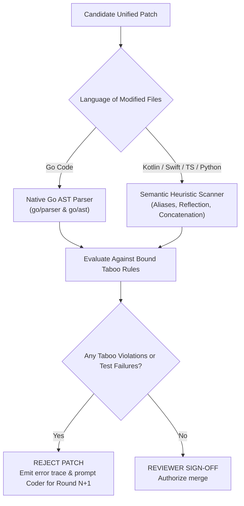

# Artix AI Platform: Core Technical Architecture & Internals

**Platform:** `artix-ai` (Go 1.27 & Compose Desktop)  
**Author:** Kolta Labs Core Systems Architecture  
**Audience:** Compiler Engineers, DevOps Architects, Core Contributors  
**Scope:** Shadow worktree mechanics, sandbox execution containment, AST taboo reviewers, LSP 3.17 server, and webhook daemons.

---

## 1. Package Architecture & Dependency Graph

The Artix codebase is organized into cleanly decoupled packages under `artix-ai/`:

```text
artix-ai/
├── cli/                   # Native CLI frontend (main.go, repl.go, explain.go)
├── cmd/artixd/            # Autonomous webhook server daemon (GitHub & GitLab)
├── app/                   # Compose Multiplatform Desktop Cockpit (KMP / KoltLibs)
└── pkg/
    ├── coder/             # Domain Coder engine, unified diff generator, budget tracking
    ├── reviewer/          # Adversarial Reviewer, AST taboo guards, heuristic scanners
    ├── spec/              # Chamber 1 Stakeholder Council, Gherkin formatter, ADR builder
    ├── git/               # Git shadow worktree driver, atomic patch application
    ├── sandbox/           # OS-level execution confinement (sandbox-exec / bwrap)
    ├── steering/          # Taboo rules, persona bindings, remote standards syncer
    ├── knowledge/         # Self-evolving repository memory, breakthrough extractor
    ├── lsp/               # Language Server Protocol 3.17 daemon
    ├── mcp/               # Model Context Protocol connectors and clients
    ├── forge/             # Webhook worker pool, PR creator, GitHub/GitLab clients
    ├── policy/            # Allowed drivers allowlist, autonomous permissions
    └── persona/           # SWE persona registry, cognitive priors
```

---

## 2. Shadow Git Worktrees (`pkg/git/worktree.go`)

Traditional AI coding agents execute edits directly against the user's active working tree. If an edit fails, files are corrupted, unstaged changes are mingled, and multitasking is impossible.

Artix solves this with **Shadow Git Worktrees**:

```mermaid
sequenceDiagram
    autonumber
    actor Dev as Developer (Active Workspace)
    participant Engine as Artix Coder Engine
    participant Git as Local Git Subsystem
    participant WT as Shadow Worktree (.artix/worktrees/task-101)
    participant Box as Isolated Test Sandbox

    Dev->>Engine: Runs 'artix code docs/specs/STORY-101.md'
    Engine->>Git: git worktree add .artix/worktrees/task-101 HEAD
    Git-->>WT: Creates isolated filesystem worktree
    Note over Dev: Developer continues editing active files without interruption!
    Engine->>WT: Domain Coder generates atomic unified patch
    WT->>Box: Executes './gradlew test --offline'
    Box-->>Engine: 100% Tests Green
    Engine->>Dev: Prompts: "Tests Passed! Squash & Merge into active branch?"
    Dev->>Engine: Confirms Merge
    Engine->>Git: git merge --squash .artix/worktrees/task-101
    Engine->>Git: git worktree remove .artix/worktrees/task-101
```

---

## 3. Sandboxed Execution Isolation (`pkg/sandbox/exec.go`)

To protect the developer's workstation from malicious dependency scripts or runaway file modifications, Artix wraps all build and test executions in an OS-level sandbox:

### Confinement Strategy
- **macOS**: Generates dynamic **Apple Seatbelt profiles** (`sandbox-exec`):
  ```scheme
  (version 1)
  (deny default)
  (deny network*)
  (allow file-read*)
  (allow file-write* (subpath "/path/to/.artix/worktrees/task-101"))
  (allow file-write* (subpath "/private/tmp"))
  (allow process-exec)
  ```
- **Linux**: Executes via **Bubblewrap (`bwrap`)**:
  ```bash
  bwrap --unshare-net --ro-bind / / --bind $WORKTREE_PATH $WORKTREE_PATH --tmpfs /tmp ...
  ```
- **Network Isolation**: All test executions run in complete network isolation (`--offline`).
- **Offline Cache Pre-Warming (`artix warm`)**: Required dependencies must be warmed prior to sandbox execution. Cold misses trigger an immediate `OFFLINE_CACHE_MISS` error naming the un-cached artifact.

---

## 4. Adversarial Reviewer & AST Taboo Guards (`pkg/reviewer/`)

The Adversarial Reviewer operates in two distinct scanning modes:



1. **Go Code (`scan mode: diff-literal | AST`)**:
   - Parses AST directly using Go standard library `go/parser` and `go/ast`.
   - Inspects full call graphs, type definitions, and package imports.
   - Detects package aliasing (e.g. `import badpkg "malicious/pkg"`).
2. **Non-Go Languages (`scan mode: heuristic`)**:
   - Analyzes Kotlin, Swift, Python, and TypeScript diffs using semantic regex patterns.
   - Identifies import alias obfuscation (`import java.lang.Runtime as EvilRuntime`).
   - Identifies dynamic reflection calls (`Class.forName(...)`, `getMethod(...)`).
   - Identifies split string concatenation attacks (`"NS" + "Task"`).

---

## 5. Driver Allowlists & Governance (`pkg/policy/`)

To prevent unauthorized build execution across untrusted repositories, Artix enforces an explicit **Driver Allowlist**:

```json
{
  "allowedDrivers": ["go", "gradle"],
  "allowAutonomous": false,
  "maxRounds": 3,
  "perRoundTimeoutSeconds": 180
}
```

- By default, only `go` and `gradle` drivers are permitted.
- Unallowed build systems (e.g. `cargo`, `npm`, `swiftpm`, `xcode`) are rejected before any LLM inference tokens are burned unless explicitly allowed in repository policy.
- Autonomous mode (`--autonomy autonomous`) requires a verified, cryptographically signed policy file with `allowAutonomous: true`.

---

## 6. Language Server Protocol (LSP 3.17) Daemon (`pkg/lsp/server.go`)

Artix exposes a standard LSP 3.17 server over `stdio` via `artix lsp`:
- **`textDocument/publishDiagnostics`**: Emits live squiggly lines in the editor whenever a developer types code violating an active Taboo Space.
- **`textDocument/codeLens`**: Renders clickable buttons above class definitions (e.g. `⚡ Artix: Deliberate Story Spec`).
- **`textDocument/codeAction`**: Offers quick-fix refactor actions to automatically repair architectural violations.

---

## 7. Autonomous Webhook Daemon (`artixd`) Security Model

For continuous autonomous development, `artixd` handles GitHub and GitLab webhooks:

| Threat Vector | Defense Mechanism | Behavior on Attack |
|---|---|---|
| **Forged Sender** | HMAC-SHA256 signature verification (`X-Hub-Signature-256`) | `401 Unauthorized` |
| **Untrusted Actor** | `author_association` verified (`OWNER`, `MEMBER`) | `403 Forbidden` |
| **Replay Attacks** | Delivery UUID tracking with 10-minute sliding cache | `409 Conflict` |
| **Prompt Injection** | AST Prompt Sanitizer strips malicious jailbreaks | `400 Bad Request` |
| **Payload DoS** | Body capped at `--max-body-length` (default: 32 KB) | `413 Request Entity Too Large` |

---

*Next: Continue to [Artix AI Platform: User Guide & Cockpit Manual](../artix-ai/03_USER_GUIDE_AND_COCKPIT.md).*
