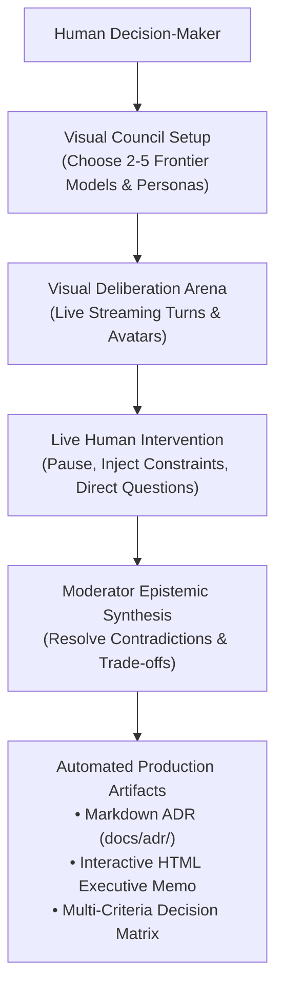

# Dialex AI Client: Conceptual Foundation & Visual Deliberation

**Client:** `dialex-ai` (Kotlin Multiplatform / Compose Multiplatform)  
**Author:** Keltstone Systems UI/UX & Cognitive Systems Group  
**Audience:** Product Managers, Enterprise Architects, Mobile & Desktop Engineers  
**Scope:** Synthetic advisory boards, visual epistemology, Hegelian interface design, and decision artifacts.

---

## 1. The Need for a Visual Deliberation Workbench

While the `socratix-engine` acts as the headless reasoning daemon, human decision-makers need a **visual cognitive cockpit** to:
1. Observe competing AI models debating in real time with distinct visual avatars and identities.
2. Intervene instantly with human authority when models veer into speculative tangents.
3. Inspect dialectic tension graphs, Bayesian credence trajectories, and knowledge nodes.
4. Export finalized consensus directly into production deliverables (**ADRs**, **Weighted Decision Matrices**, **Executive HTML Memos**).

---

## 2. Synthetic Advisory Boards

Most enterprises cannot afford to assemble a team of world-class principal architects, security researchers, financial quants, and compliance lawyers for every medium-sized architectural choice.

**Dialex AI simulates a Synthetic Advisory Board**:
- **Seat 1 (Principal Systems Architect)**: Defends modularity, loose coupling, schema evolution, and long-term maintainability.
- **Seat 2 (Staff Site Reliability Engineer)**: Defends uptime SLAs, failure domains, blast radius containment, and MTTR.
- **Seat 3 (Offensive Security / Red Team Lead)**: Defends zero-trust invariants, threat models, cryptographic verification, and privilege minimization.
- **Seat 4 (VP of Finance / FinOps Lead)**: Defends AWS/GCP cloud bills, egress bandwidth costs, and license compliance.
- **Seat 5 (Neutral Moderator)**: Keeps participants anchored to the core question, enforces the anti-fluff directive, and synthesizes the final ADR.

---

## 3. Epistemic Transparency & Deliverables

Traditional chat interfaces produce ephemeral markdown answers that disappear into chat history. Dialex AI crystallizes every deliberation into durable, enterprise-grade deliverables:

### 3.1 Architecture Decision Records (ADRs)
Standard Markdown documents generated in compliance with the **Michael Nygard format**:
- **Title**: Context and decision name.
- **Status**: Proposed / Accepted / Rejected.
- **Context**: Problem statement and competing requirements.
- **Decision Outcome**: Chosen architecture.
- **Consequences**: Explicit positive trade-offs and admitted negatives.
- **Compliance Link**: Written directly to `docs/adr/ADR-<number>.md`.

### 3.2 Weighted Multi-Criteria Decision Matrices
Tabular comparisons scoring competing solutions (e.g. Solution A vs. Solution B vs. Solution C) against normalized criteria (e.g., Latency, Complexity, Operational Cost, Security) with explicit mathematical weights:
$$\text{Score}_k = \sum_{j=1}^M w_j \cdot s_{k, j}$$

### 3.3 Executive Memos (Interactive HTML)
Self-contained, styled HTML documents featuring executive summaries, key bullet points, interactive radar charts, and collapsible debate transcripts—ready to email to C-level executives or board members.

---

*Next: Continue to [Dialex AI Client: Core Technical Architecture](../dialex-ai/02_CORE_TECHNICAL_ARCHITECTURE.md).*
