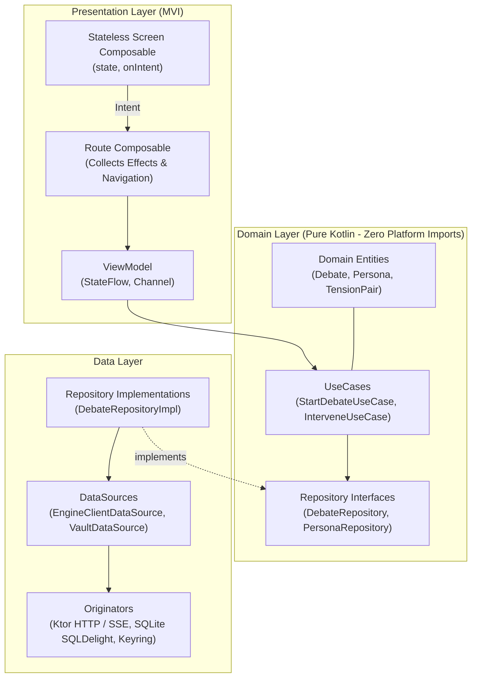

# Dialex AI Client: Core Technical Architecture & Internals

**Client:** `dialex-ai` (Kotlin Multiplatform / Compose Multiplatform)  
**Author:** Keltstone Systems Core Mobile & Desktop Architecture  
**Audience:** KMP Developers, Compose Architects, Contributors  
**Scope:** Strict Clean Architecture layering, Unidirectional MVI contracts, KoltLibs integration, and Vault security.

---

## 1. Clean Architecture Call Chain

In compliance with the **Keltstone KMP Engineering Standards**, `dialex-ai` enforces a strict, unidirectional call chain with zero skipped layers:

```
ViewModel ──► UseCase ──► Repository (Domain Interface) ──► RepositoryImpl ──► DataSource ──► Originator (Ktor / Engine / SQLite)
```



### Invariants Enforced by Architecture Tests
1. **Zero Platform Imports in Domain**: The `domain` package has 0 imports from `android.*`, `androidx.compose.*`, or `java.*`.
2. **No Same-Layer Dependencies**: A `UseCase` never calls another `UseCase`; a `RepositoryImpl` never calls another `RepositoryImpl`. Shared peer logic is extracted into pure utility functions.
3. **Immutability Mandate**: Every collection inside a UI `State` is an `ImmutableList`, `ImmutableSet`, or `ImmutableMap` (`kotlinx.collections.immutable`), preventing unstable Compose recomposition loops.

---

## 2. Unidirectional MVI (`Contract.kt`)

Every screen in `dialex-ai` lives in its own dedicated package under `presentation/` (e.g. `presentation/arena/`, `presentation/chat/`, `presentation/setup/`) and contains a single `Contract.kt` defining its MVI tripartite contract:

```kotlin
package com.dialex.presentation.arena

import androidx.compose.runtime.Immutable
import kotlinx.collections.immutable.ImmutableList
import kotlinx.collections.immutable.persistentListOf
import com.dialex.domain.model.DebateMessage
import com.dialex.domain.model.TensionPair

interface ArenaContract {

    @Immutable
    data class State(
        val debateId: String? = null,
        val topic: String = "",
        val currentRound: Int = 1,
        val isPaused: Boolean = false,
        val isStreaming: Boolean = false,
        val messages: ImmutableList<DebateMessage> = persistentListOf(),
        val activeTensions: ImmutableList<TensionPair> = persistentListOf(),
        val consensusRatio: Float = 0.0f,
        val error: String? = null
    )

    sealed interface Intent {
        data object TogglePauseResume : Intent
        data class InjectHumanRemark(val remark: String) : Intent
        data object ConcludeEarly : Intent
        data class CopyMessage(val messageId: String) : Intent
        data object ExportAdr : Intent
    }

    sealed interface Effect {
        data class ShowSnackbar(val message: String) : Effect
        data class NavigateToDeliverable(val path: String) : Effect
        data object ScrollToBottom : Effect
    }
}
```

### The Route vs. Screen Separation
- **The Stateless Screen (`ArenaScreen.kt`)**: Receives only `state: ArenaContract.State`, `onIntent: (ArenaContract.Intent) -> Unit`, and resolved navigation callbacks. It never sees a `ViewModel`, a CoroutineScope, or a raw `Flow`. It is 100% `@Preview`-able with fake data.
- **The Route Composable (`ArenaRoute.kt`)**: The **only** collector of the ViewModel's `Channel<Effect>` flow. It resolves navigation effects directly into the back stack and passes simple callbacks down to the Screen.

---

## 3. Design System & Kolt Tokens (`KoltLibs`)

Dialex AI strictly enforces the **Keltstone Design Token System** (`Kolt.colors`, `Kolt.sizes`, `Kolt.typography`):

```kotlin
// Strictly Forbidden:
Text("Debate Topic", fontSize = 18.sp, color = Color(0xFF1E1E1E), modifier = Modifier.padding(16.dp))

// Required Dialex Standard:
KoltText(
    text = state.topic,
    style = Kolt.typography.title.large.bold,
    color = Kolt.colors.textPrimary,
    modifier = Modifier.padding(Kolt.sizes.spacing.medium)
)
```

- **Buttons**: `KoltButton`, `KoltOutlinedButton`.
- **Text & Dropdowns**: `KoltText`, `KoltDropdown`.
- **Surfaces & Cards**: `TitledCardView`, `SmoothCornerShape`.
- **Sheets & Feedback**: `KoltBottomSheet`, `KoltEmptyState`, `KoltStatusTag`.

---

## 4. `EngineClient`: Ktor SSE Transport

The interface between the KMP client and the Go `socratix-engine` is encapsulated inside `EngineClient.kt` in `shared/`:

```kotlin
class EngineClient(
    private val httpClient: HttpClient,
    private val baseUrl: String
) {
    suspend fun streamDebate(debateId: String): Flow<DebateStreamEvent> = flow {
        httpClient.prepareGet("$baseUrl/api/v1/debates/$debateId/stream") {
            header(HttpHeaders.Accept, "text/event-stream")
        }.execute { response ->
            val channel = response.bodyAsChannel()
            while (!channel.isClosedForRead) {
                val line = channel.readUTF8Line() ?: break
                if (line.startsWith("data: ")) {
                    val json = line.removePrefix("data: ")
                    val event = Json.decodeFromString<DebateStreamEvent>(json)
                    emit(event)
                }
            }
        }
    }
}
```

---

## 5. Security Vault & Platform Keyring

- **Android (`androidMain`)**: Implements `actual class SecureVault` backed by `AndroidKeyStore`, generating an AES-256-GCM cipher key bound to user biometric authentication (Fingerprint / Face Unlock).
- **Desktop (`jvmMain`)**: Implements `actual class SecureVault` backed by macOS Keychain via JNA or Windows Credential Manager, with an encrypted local file fallback guarded by Argon2id.

---

*Next: Continue to [Dialex AI Client: User Guide & Workflows](../dialex-ai/03_USER_GUIDE_AND_WORKFLOWS.md).*
