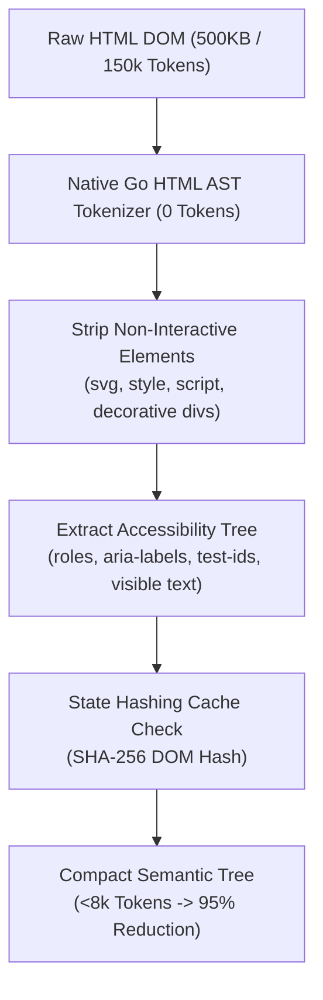
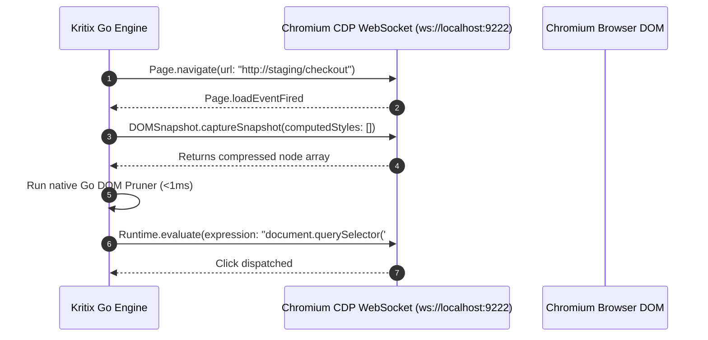
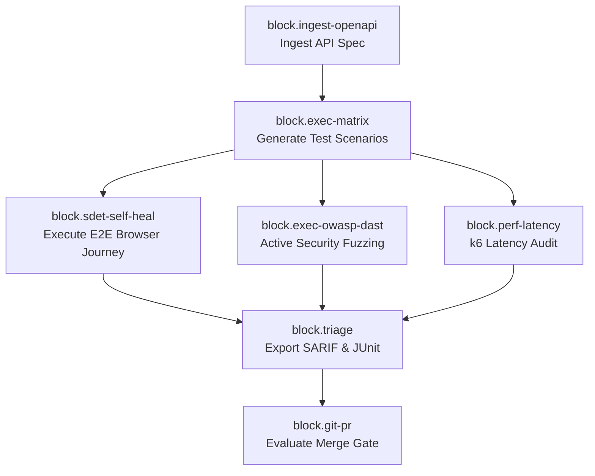

# Kritix AI Platform: Core Technical Architecture & Internals

**Platform:** `kritix-ai` (Go 1.27 & Compose Desktop)  
**Author:** Keltstone Systems Core Systems Architecture  
**Audience:** SDET Architects, Performance Engineers, Security Auditors  
**Scope:** DOM pruning algorithms, CDP virtual driver, self-healing locator math, DAG workflow pipeline, and DAST fuzzers.

---

## 1. Package Architecture & Subsystems

```text
kritix-ai/
├── cmd/kritix/            # Native CLI entrypoint (studio, run, spec, roi, auth)
├── app/                   # Compose Multiplatform Desktop Cockpit (KMP / KoltLibs)
└── pkg/
    ├── optimizer/         # DOM semantic pruning, state hashing cache, token ROI calculator
    ├── sdet/              # Multi-factor self-healing locators, N-effective scoring, regressions
    ├── driver/            # Chrome DevTools Protocol (CDP) virtual driver, accessibility tree
    ├── workflow/          # Composable Block DAG pipeline engine, prebuilt blueprints
    ├── security/          # OWASP Top 10 DAST fuzzing, PII redaction, scope guardrails
    ├── perf/              # k6 load / spike / soak scenario generator, SLA evaluator
    ├── quarantine/        # Flaky test statistical retries, exponential backoff, SLA gate
    ├── triage/            # Playwright TS generator, curl builder, SARIF & JUnit XML
    ├── auth/              # AES-256-GCM encrypted state, RFC 6238 TOTP, RBAC & audit log
    ├── server/            # Embedded HTTP server, SSE telemetry stream, embedded Web UI
    └── studio/            # "Teach the Agent" demonstration recorder, BDD synthesizer
```

---

## 2. Structural DOM Pruning Engine (`pkg/optimizer/`)

Traditional testing agents dump full HTML DOM strings containing thousands of decorative divs, CSS classes, SVG paths, inline styles, and hidden layout containers into LLM prompts.



### Pruning Pipeline Steps
1. **Node Stripping**: Removes `<style>`, `<script>`, `<svg>`, `<iframe>`, comments, and hidden elements (`display: none`, `aria-hidden="true"`).
2. **Attribute Normalization**: Strips decorative CSS class strings and inline style blocks, preserving only test attributes: `id`, `data-testid`, `name`, `role`, `aria-label`, `type`, `placeholder`, and `href`.
3. **Semantic Accessibility Tree Extraction**: Transforms remaining nodes into a hierarchical tree format:
   ```text
   [BUTTON id="submit-btn" text="Complete Order" enabled="true"]
   [INPUT type="password" name="pin" placeholder="Enter 6-digit PIN"]
   ```
4. **State Hashing & Deduplication**: Calculates a SHA-256 hash of the interactive tree. If an action does not alter interactive state, subsequent LLM inference calls are bypassed completely.

---

## 3. Chrome DevTools Protocol (CDP) Driver (`pkg/driver/cdp.go`)

Kritix does not require heavy Node.js or Selenium dependencies to automate browsers; it drives Chromium instances directly via a native Go WebSocket client over the **Chrome DevTools Protocol (CDP)**:



---

## 4. Multi-Factor Self-Healing Locators (`pkg/sdet/locator.go`)

When UI changes break a traditional test locator (e.g. an element ID changed from `#checkout-v1` to `#checkout-v2`), traditional tests fail.

Kritix resolves broken locators using a multi-factor heuristic scoring function:

$$S_{\text{candidate}} = w_1 \cdot M_{\text{text}} + w_2 \cdot M_{\text{role}} + w_3 \cdot M_{\text{tag}} + w_4 \cdot M_{\text{hierarchy}}$$

where weights are calibrated:
- $w_1 = 0.45$ (Visible Text Match)
- $w_2 = 0.25$ (Accessibility Role Match)
- $w_3 = 0.15$ (HTML Tag Match)
- $w_4 = 0.15$ (Tree Hierarchy Proximity)

### The Strict Safety Guarantee
A broken locator is **never** healed onto an element that does not share its original visible text. A button that moved into the old coordinate spot but has different text is recognized as an architectural regression, not a heal.

---

## 5. Composable Block DAG Pipeline Engine (`pkg/workflow/`)

Test pipelines are modeled as Directed Acyclic Graphs (DAGs) composed of discrete, reusable execution blocks:



### Prebuilt Blueprints
1. `pr-smoke-guard`: Runs fast interactive smoke journeys, asserts 0 regressions, and gates pull requests.
2. `security-dast-audit`: Executes OWASP Top 10 fuzzing against allowed endpoints.
3. `self-healing-maintenance`: Runs test suites in `advisory` mode, proposing automated Git patches for shifted selectors.

---

*Next: Continue to [Kritix AI Platform: User Guide & Testing Workflows](../kritix-ai/03_USER_GUIDE_AND_STUDIO.md).*
