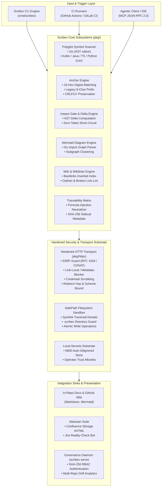
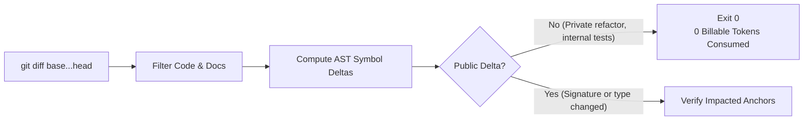
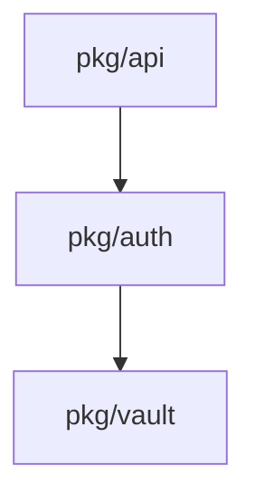

# Scribex AI: Core Technical Architecture & Engine Internals

**Module:** `scribex-ai`  
**Author:** Keltstone Systems Core Engineering & Knowledge Architecture Group  
**Audience:** Principal Architects, Systems Programmers, DevSecOps Engineers, Platform Leads  
**Scope:** Internal architecture, polyglot symbol extraction, AST hashing, network security, RBAC daemon, and MCP protocol implementation.

---

## 1. System Architecture Overview

Scribex AI is implemented in pure **Go 1.27** with zero external CGO dependencies, enabling bit-for-bit reproducible static binaries across Linux (amd64, arm64) and macOS (Darwin amd64, arm64).



---

## 2. Polyglot Symbol Scanner & AST Parsing (`pkg/symbols`)

To maintain deterministic accuracy without depending on heavyweight language servers or compiler toolchains for every language, Scribex uses a **hybrid parsing architecture**:

### 2.1 Native Go AST Parsing
For Go code, Scribex utilizes the standard library `go/parser` and `go/ast`:
- Parses package declarations, imports, structs, interfaces, functions, methods, and constants.
- Extracts fully qualified symbol paths (e.g., `pkg/auth/jwt.go#VerifyToken`, `pkg/api/server.go#Server.ServeHTTP`).
- Normalizes signatures by stripping whitespace, unexporting private comments, and standardizing parameter type representations.

### 2.2 Polyglot Lexical Scanners (Kotlin, Java, TypeScript/JS, Python)
For non-Go files, Scribex provides high-speed lexical scanners that extract exported signatures with precision:

| Language | Scanner Mode | Signature Extraction Target | Supported Constructs |
| :--- | :--- | :--- | :--- |
| **Go** | Native Go AST | Functions, Methods, Types, Interfaces | `func`, `type ... struct`, `type ... interface` |
| **Kotlin** | Lexical Scanner | Classes, Interfaces, Functions, Properties | `fun`, `class`, `interface`, `val`, `var` |
| **Java** | Lexical Scanner | Public Classes, Interfaces, Methods | `public class`, `public interface`, `public <T> ...` |
| **TypeScript / JS**| Lexical Scanner | Exported Functions, Classes, Types, Interfaces | `export function`, `export class`, `export type`, `export interface` |
| **Python** | Indentation Scanner | Top-level Classes, Functions, Async Defs | `def`, `class`, `async def` |

### 2.3 Cryptographic Signature Hashing
Every symbol signature is hashed into a canonical **16-hex character digest** (first 8 bytes of SHA-256):

$$\text{SigHash} = \text{HexEncode}\Big(\text{SHA-256}(\text{NormalizedSignature})[0:8]\Big)$$

- **Legacy Hash Compatibility:** Earlier Scribex versions used 8-character hex hashes (first 4 bytes of SHA-256). The verification engine checks whether stored 8-character hashes match the prefix of the computed 16-character hash. `scribex sync` automatically upgrades legacy hashes to full 16-hex digests.
- **Line Ending Neutrality:** Document scanners preserve the existing document line endings (`\n` or `\r\n`) byte-for-byte during signature rewrites.

---

## 3. Code-to-Doc Anchor Engine (`pkg/anchors`)

The anchor engine scans Markdown files for HTML comments delineating documented code symbols:

```markdown
<!-- @scribex:anchor(pkg/auth/jwt.go#VerifyToken,sig=7f8a9b0c1d2e3f4a) -->
### VerifyToken
Validates incoming JWT bearer tokens using the RS256 algorithm.
<!-- /@scribex:anchor -->
```

### Parsing State Machine
The parser reads Markdown documents line-by-line using a finite state machine:
1. **Search State:** Scans for `<!-- @scribex:anchor(file#symbol[,sig=hash]) -->`.
2. **Body State:** Accumulates documentation prose, code snippets, or tables until it encounters the terminating tag: `<!-- /@scribex:anchor -->` or `<!-- @scribex:end -->`.
3. **Validation State:**
   - Detects unterminated anchors (missing close tag).
   - Detects nested anchors (anchors placed inside another active anchor).
   - Flags missing code files or deleted code symbols (`CodeDead`).
   - Flags modified signatures whose stored `sig` does not match the active code signature (`CodeStale`).

### Anchor Issue Classification

| Code | Severity | Description | Remediated By |
| :--- | :--- | :--- | :--- |
| `dead` | Error | Target code file or symbol does not exist in the repository. | Remove anchor or fix symbol name in doc. |
| `stale` | Warning / Error | Code signature changed; stored `sig` hash does not match code. | Run `scribex sync` (deterministic) or `scribex sync -ai`. |
| `unmatched` | Error | Malformed anchor syntax or unparseable symbol path. | Fix syntax in Markdown file. |
| `ai-rejected` | Warning | AI prose rewrite failed validation (anchor left unchanged). | Review error output; check style guide or secrets. |
| `ai-failed` | Error | LLM provider API failed or exhausted `ai.max_calls`. | Verify API credentials and connectivity. |

---

## 4. Zero-Token Impact Gate & Delta Engine (`pkg/docs`)

When running in CI environments during Pull Requests (`scribex check -base origin/main`), Scribex calculates the AST delta between the feature branch and the target branch:



1. **Change Classification:**
   - `added`: New exported symbol introduced.
   - `modified`: Exported signature, parameters, return type, or contract modified.
   - `deleted`: Exported symbol removed or unexported.
2. **Short-Circuit Logic:** If all changes in the PR are internal to function implementations, private variables, or untracked test fixtures, `gate()` returns `false`. CI completes in milliseconds without invoking external APIs.

---

## 5. Hardened HTTP Transport & Zero-Trust Security (`pkg/httpx`)

All outbound HTTP calls made by Scribex (Atlassian REST API, GitHub API, Anthropic API, OpenAI API) are mediated by the hardened `httpx` client:

### 5.1 Server-Side Request Forgery (SSRF) Guard
By default, the client dials IP addresses directly and rejects:
- **RFC 1918 Private Ranges:** `10.0.0.0/8`, `172.16.0.0/12`, `192.168.0.0/16`
- **Carrier-Grade NAT (CGNAT):** `100.64.0.0/10`
- **Loopback Addresses:** `127.0.0.0/8`, `::1`
- **Link-Local & Cloud Metadata:** `169.254.0.0/16`, `fe80::/10` (protecting AWS/GCP/Azure instance metadata endpoints like `http://169.254.169.254/latest/meta-data/`)

### 5.2 Private Network Opt-In for On-Premise Deployments
Organizations running self-hosted Jira Data Center, Confluence Server, or GitHub Enterprise Server inside private VPCs can allow private IP routing by setting:
```bash
export SCRIBEX_ALLOW_PRIVATE_HOSTS=1
```
> **Security Invariant:** Even when `SCRIBEX_ALLOW_PRIVATE_HOSTS=1` is set, cloud instance metadata endpoints (`169.254.169.254`) and link-local IPv6 addresses remain permanently blocked.

### 5.3 Redirection & Credential Boundaries
- Cross-host redirects are refused.
- Scheme downgrades (HTTPS to HTTP) are refused.
- Maximum redirect hops is capped at 3.
- When following allowed redirects, sensitive authentication headers (`Authorization`, `x-api-key`) are stripped if redirecting across boundary domains.
- All HTTP error messages and logged responses are scrubbed for known secrets and API tokens.

---

## 6. Living Mermaid Diagram Synthesis (`pkg/diagram`)

Documentation diagrams rapidly become obsolete when maintained by hand. Scribex parses native Go imports across repository packages to construct live Mermaid dependency graphs:

```markdown
<!-- @scribex:diagram -->

<!-- /@scribex:diagram -->
```

- Invoking `scribex diagram` scans all Go files, extracts package-level dependencies, strips vendor and third-party modules, and formats the output into clean Mermaid syntax.
- Existing diagram comment blocks in READMEs or architectural guides are replaced atomically.

---

## 7. Interlinked Wiki Engine (`pkg/wiki`)

Scribex includes an integrated wiki engine for connected technical knowledge bases:
- **Wikilink Syntax:** Supports `[[Page]]` and `[[Page|Anchor Label]]`, as well as standard relative Markdown links (`./getting-started.md`).
- **Normalized Keying:** Page names are case-insensitive, space-insensitive, and hyphen-insensitive (e.g., `[[Getting Started]]` matches `getting-started.md`).
- **Backlinks Inverted Index:** Calculates bidirectional reference graphs, allowing developers or agents to query all pages that link to a target document.
- **Linting & Orphan Detection (`scribex wiki lint`):** Flags broken links, duplicate page titles, and orphan pages that are unreachable from the designated `wiki.home` page (`Home.md`).
- **Static Export (`scribex wiki render -out dir`):** Transforms the internal wikilink mesh into clean relative Markdown links with automated "Linked from:" footers, ready for push to GitHub Wiki repos (`.wiki.git`) or static site generators.

---

## 8. Multi-Repo Governance Daemon & RBAC (`pkg/dashboard`)

For engineering organizations managing tens or hundreds of repositories, `scribex serve` provides a high-performance HTTP governance daemon:

```
┌────────────────────────────────────────────────────────┐
│               Scribex Governance Daemon                │
│                 (scribex serve :8080)                  │
├──────────────────────────┬─────────────────────────────┤
│      Web Dashboard       │         REST API            │
│  - Team-Scoped Repos     │  - GET /api/v1/health       │
│  - Stale Anchor Count    │  - GET /api/v1/repos        │
│  - Dead Symbol Alerts    │  - GET /api/v1/trace.csv    │
│  - Read-Only /config     │  - GET /api/v1/metrics      │
├──────────────────────────┴─────────────────────────────┤
│                RBAC Authentication Engine              │
│      HTTP Basic Auth: User + SHA-256 Hashed Token      │
│      Roles: admin | viewer (Scoped by team ownership)  │
└────────────────────────────────────────────────────────┘
```

- **Authentication:** Clients authenticate using HTTP Basic Auth. Passwords are validated against pre-computed SHA-256 hashes stored in the `rbac` configuration file (`scribex hash-token <token>`).
- **Team Isolation:** Repositories are mapped to engineering teams (`name path team`). Team members only see documentation metrics and drift reports for their assigned repositories; administrators have global visibility.
- **In-Memory Measurement Caching:** Anchor scans and drift measurements are cached in memory with a configurable TTL (`-cache-ttl 30s`) to prevent disk I/O exhaustion under heavy monitoring.
- **Hardened Admin UI:** The `/config` view displays provider configurations and set/unset secret statuses, but never displays secret values or permits credential editing over HTTP.

---

## 9. Model Context Protocol (MCP) Server Architecture (`pkg/mcp`)

Scribex acts as both an **MCP client config manager** and a **sovereign MCP server**:

```json
{
  "mcpServers": {
    "scribex": {
      "command": "scribex",
      "args": ["mcp", "serve", "-C", "."]
    }
  }
}
```

When running `scribex mcp serve`, Scribex speaks standard newline-delimited JSON-RPC 2.0 over standard input and output (`stdio`), exposing read-only documentation tools to AI agents (Claude Desktop, Cursor, Antigravity, Socratix Engine):

| MCP Tool Name | Description | Parameters |
| :--- | :--- | :--- |
| `scribex_check` | Returns current anchor drift and stale doc status in Markdown format. | *(None)* |
| `scribex_wiki_lint` | Evaluates wiki structure, reporting broken links, orphans, and duplicates. | *(None)* |
| `scribex_wiki_search` | Searches all wiki page titles and body text for keywords. | `query` (string) |
| `scribex_wiki_page` | Retrieves full markdown body for a named wiki page. | `name` (string) |
| `scribex_wiki_backlinks` | Returns all pages linking to the target page. | `name` (string) |

> **Security Guard:** The MCP server is strictly read-only. AI agents cannot overwrite files, execute code, or exfiltrate credentials over MCP.
