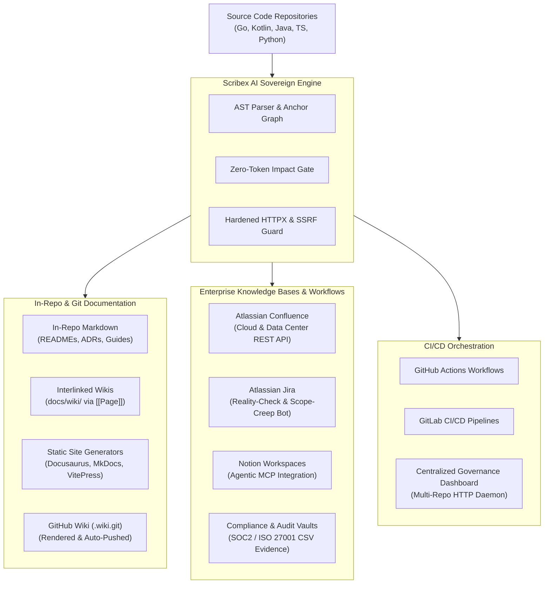

# Scribex AI: Master Platform Integration & Setup Guide

**Module:** `scribex-ai`  
**Author:** Keltstone Systems Core Engineering & Knowledge Architecture Group  
**Audience:** Platform Engineers, DevOps/DevSecOps Engineers, Systems Administrators, Tech Leads  
**Scope:** Integration architecture, platform matrix, credentials management, network security policies, and links to platform-specific deep-dive setup guides.

---

## 1. Documentation Platforms Ecosystem

Modern enterprise documentation rarely lives in a single repository. Organizations distribute knowledge across developer READMEs, team wikis, project trackers, static documentation portals, and corporate intranets.

Scribex AI acts as the **central synchronization and verification fabric** uniting these disparate platforms:



---

## 2. Platforms Compatibility & Capability Matrix

| Platform | Integration Mode | Read / Pull | Write / Push | Auth Method | Dedicated Setup Guide |
| :--- | :--- | :---: | :---: | :--- | :--- |
| **Atlassian Confluence** | REST API (`/wiki/rest/api`) | Yes | Yes (Drafts) | API Token / OAuth | [Confluence Setup Guide](platforms/confluence.md) |
| **Atlassian Jira** | REST API (`/rest/api/2`) | Yes | Yes (Comments) | API Token / Basic | [Jira Setup Guide](platforms/jira.md) |
| **GitHub Actions / PRs** | CLI / GitHub API / Action | Yes | Yes (Comments, PRs) | `GITHUB_TOKEN` | [GitHub Setup Guide](platforms/github.md) |
| **GitLab CI/CD** | CLI Runner / GitLab API | Yes | Yes (MR Gating) | CI/CD Variables | [GitLab Setup Guide](platforms/gitlab.md) |
| **In-Repo Markdown & Wikis** | Native Filesystem (AST) | Yes | Yes (Atomic) | Git / File system | [Markdown & Wikis Guide](platforms/markdown_and_wikis.md) |
| **Notion Workspaces** | Model Context Protocol | Yes | Via Agent | Internal Token | [Notion Setup Guide](platforms/notion.md) |
| **SOC2 / Compliance Vaults** | CSV & JSON Sidecar Export | Yes | File / S3 / Vault | Filesystem / CI | [Compliance & Audit Guide](platforms/compliance_and_audit.md) |
| **Governance Dashboard** | Dedicated Go Daemon | Yes | Read-Only UI | SHA-256 Tokens | [Dashboard Setup Guide](platforms/governance_dashboard.md) |

---

## 3. Global Prerequisites & Security Architecture

Before configuring any platform integration, review these fundamental security guidelines:

### 3.1 Secrets Management Rule: Never Commit Plaintext Keys
1. **Committed Configs:** `.scribex/config.yaml`, `.scribex/manifest.yaml`, and `.scribex/mcp.json` are committed to git. They must **never** contain literal secret strings, passwords, or raw tokens.
2. **Local Development:** Store secrets in `.scribex/secrets.env` using `scribex secrets set <NAME>`. This file is permission-restricted (`0600`) and automatically added to `.gitignore`.
3. **CI/CD Pipelines:** Use platform secret vaults (GitHub Secrets, GitLab Protected Variables, AWS Secrets Manager). Environment variables always take precedence over `secrets.env`.

### 3.2 Private Network & SSRF Guard (`SCRIBEX_ALLOW_PRIVATE_HOSTS`)
The Scribex hardened HTTP transport strictly blocks RFC 1918 private subnets (`10.0.0.0/8`, `172.16.0.0/12`, `192.168.0.0/16`) and loopback addresses by default to prevent Server-Side Request Forgery.

When connecting to on-premise platforms hosted behind corporate firewalls (e.g., self-hosted Confluence Data Center, Jira Server, or GitHub Enterprise Server):
```bash
# Enable routing to internal enterprise subnets:
export SCRIBEX_ALLOW_PRIVATE_HOSTS=1
```
*Note: Even with this flag active, link-local addresses and cloud instance metadata (`169.254.169.254`) remain strictly forbidden.*

### 3.3 Operator Trust Allowlist for AI Endpoints
Scribex strictly enforces operator-level trust for AI endpoints (`api.anthropic.com` and `api.openai.com` are pre-trusted). Custom proxy endpoints or internal corporate gateways must be declared outside git repository control:
```bash
# Declarative environment variable allowlist:
export SCRIBEX_AI_ALLOWED_HOSTS="ai-gateway.internal.corp:8443,llm-proxy.corp.net"

# Or through operator configuration:
mkdir -p ~/.config/scribex
cat << 'EOF' > ~/.config/scribex/trust.yaml
allowed_hosts:
  - "ai-gateway.internal.corp:8443"
  - "llm-proxy.corp.net"
EOF
```

---

## 4. Platform Deep-Dive Navigation

Follow the step-by-step documentation for your specific documentation platforms:

1. 📘 **[Confluence Setup Guide](platforms/confluence.md)**  
   *Connecting Atlassian Confluence Cloud & Data Center, generating Atlassian API tokens, defining page-to-symbol manifests, draft approval workflows, and storage-format XHTML rendering.*

2. 📋 **[Jira Setup Guide](platforms/jira.md)**  
   *Connecting Jira Cloud & Data Center, automated acceptance criteria reality-checking, detecting undeclared breaking changes, and posting idempotent status comments.*

3. 🐙 **[GitHub & GitHub Enterprise Setup Guide](platforms/github.md)**  
   *Configuring GitHub Actions PR verification workflows, automated PR bot comments, post-merge living sync PRs, weekly scavenge cron, and GitHub Enterprise Server on-premise setup.*

4. 🦊 **[GitLab CI/CD Setup Guide](platforms/gitlab.md)**  
   *Deploying Scribex runners on GitLab CI, configuring protected and masked variables, merge request gating, and private network integration.*

5. 📝 **[In-Repo Markdown & Wikis Guide](platforms/markdown_and_wikis.md)**  
   *Mastering in-repo anchors (`<!-- @scribex:anchor -->`), living Mermaid dependency diagrams, interlinked `[[Wikilinks]]`, orphan linting, and GitHub Wiki (`.wiki.git`) publishing.*

6. 🧠 **[Notion Workspace via MCP Guide](platforms/notion.md)**  
   *Bridging codebase anchors with Notion workspaces via Model Context Protocol (MCP), setting up `@notionhq/notion-mcp-server`, and agentic client integration (Cursor, Claude, Antigravity).*

7. 🛡️ **[Compliance & Audit Evidence Guide](platforms/compliance_and_audit.md)**  
   *Generating formula-injection safe CSV traceability matrices (`scribex trace`), cryptographic SHA-256 JSON sidecars, and automated ingestion into SOC2/ISO 27001 audit tools (Vanta, Drata).*

8. 🖥️ **[Central Governance Dashboard Guide](platforms/governance_dashboard.md)**  
   *Deploying `scribex serve` across hundreds of repositories, team-scoped RBAC with SHA-256 tokens, TLS certificate termination, and Caddy/Nginx reverse proxy configurations.*
