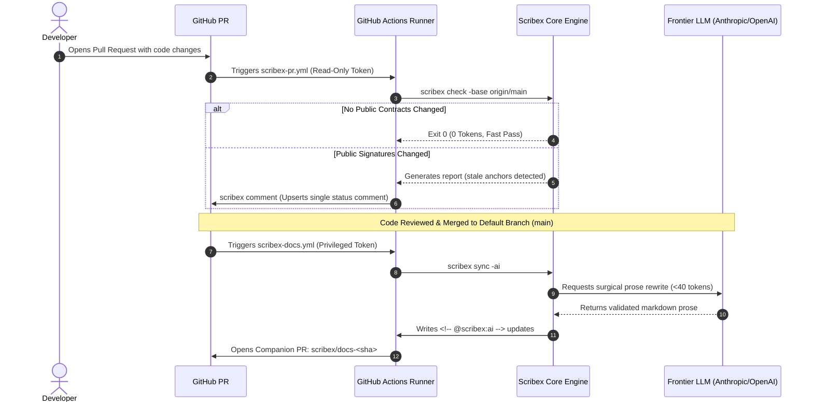

# GitHub & GitHub Actions Integration Guide

**Module:** `scribex-ai`  
**Platform:** GitHub Cloud & GitHub Enterprise Server (GHES)  
**Audience:** DevOps Engineers, CI/CD Architects, Security Engineers, Open Source Maintainers  
**Scope:** Pull request gating, automated review comments, post-merge AI documentation PRs, weekly scavenging, and GitHub Enterprise Server on-premise deployment.

---

## 1. Overview & Architecture

GitHub is the collaborative center of modern engineering. Scribex AI integrates natively into GitHub through:

1. **Pull Request Quality Gate:** Running `scribex check -base origin/main` to detect stale or dead anchors before code merges.
2. **Automated PR Bot Review:** Upserting an actionable, markdown status table directly onto the pull request without spamming notifications.
3. **Post-Merge Living Sync PRs:** Running `scribex sync -ai` on the default branch to draft prose updates and submitting an automated Pull Request for human approval.
4. **Scheduled Scavenger & Wiki Linter:** Running weekly cron checks to catch dead links, broken wikilinks, and orphan documents.



---

## 2. Fast Setup: Automated Workflow Scaffolding

Scribex can automatically scaffold production-grade, hardened GitHub Actions workflows:

```bash
scribex ci init github
```

This creates three secure, vetted workflows in `.github/workflows/`:
1. `scribex-pr.yml`: Fast PR validation and status comment bot.
2. `scribex-docs.yml`: Post-merge sync and companion PR creator.
3. `scribex-scavenge.yml`: Weekly scheduled scavenge and wiki linter.

---

## 3. Workflow Deep Dive & Security Architecture

### 3.1 PR Verification & Comment Bot (`.github/workflows/scribex-pr.yml`)

This workflow runs on every pull request. It uses a **two-job architecture** for maximum security:

```yaml
name: Scribex PR Check
on:
  pull_request:

permissions: {}

concurrency:
  group: scribex-${{ github.workflow }}-${{ github.event.pull_request.number }}
  cancel-in-progress: true

jobs:
  check:
    name: Check Documentation
    runs-on: ubuntu-latest
    permissions:
      contents: read
    timeout-minutes: 10
    steps:
      - uses: actions/checkout@v4
        with:
          fetch-depth: 0
          persist-credentials: false

      - uses: actions/setup-go@v5
        with:
          go-version: '1.27.0'

      - name: Build Scribex
        run: |
          go build -trimpath -ldflags "-s -w" -o /usr/local/bin/scribex ./cmd/scribex

      - name: Run Scribex Check
        env:
          BASE_REF: ${{ github.base_ref }}
        run: |
          scribex check -base "origin/$BASE_REF" -report "$RUNNER_TEMP/scribex-report.md"

      - name: Upload Report Artifact
        if: always()
        uses: actions/upload-artifact@v4
        with:
          name: scribex-report
          path: ${{ runner.temp }}/scribex-report.md

  comment:
    name: Post PR Comment
    needs: check
    if: always() && needs.check.result != 'skipped'
    runs-on: ubuntu-latest
    permissions:
      pull-requests: write
    timeout-minutes: 5
    steps:
      - uses: actions/download-artifact@v4
        with:
          name: scribex-report
          path: ${{ runner.temp }}

      - name: Post or Update Comment
        env:
          GITHUB_TOKEN: ${{ github.token }}
          PR_NUMBER: ${{ github.event.pull_request.number }}
        run: |
          if [ -f "$RUNNER_TEMP/scribex-report.md" ]; then
            scribex comment -repo "$GITHUB_REPOSITORY" -pr "$PR_NUMBER" -body-file "$RUNNER_TEMP/scribex-report.md"
          fi
```

#### Security Guard: Why Two Separate Jobs?
- The `check` job runs with minimal `contents: read` permissions. Untrusted fork PR code cannot access elevated tokens.
- The `comment` job runs independently with `pull-requests: write` strictly to post the pre-rendered report file.

---

### 3.2 Post-Merge Living Sync & Docs PR (`.github/workflows/scribex-docs.yml`)

When changes merge into `main`, this workflow runs `scribex sync -ai` to draft updated prose and opens a Pull Request:

```yaml
name: Scribex Docs Sync
on:
  push:
    branches: [main]
  workflow_dispatch:

permissions: {}

jobs:
  docs:
    name: Sync Documentation
    runs-on: ubuntu-latest
    permissions:
      contents: write
      pull-requests: write
    environment: scribex-ai
    timeout-minutes: 15
    steps:
      - uses: actions/checkout@v4
        with:
          fetch-depth: 0
          persist-credentials: true

      - uses: actions/setup-go@v5
        with:
          go-version: '1.27.0'

      - name: Build Scribex
        run: |
          go build -trimpath -ldflags "-s -w" -o /usr/local/bin/scribex ./cmd/scribex

      - name: Validate Config and Secrets
        run: |
          scribex config validate
          scribex secrets check

      - name: Sync Documentation
        env:
          ANTHROPIC_API_KEY: ${{ secrets.ANTHROPIC_API_KEY }}
          ATLASSIAN_URL: ${{ vars.ATLASSIAN_URL }}
          ATLASSIAN_USER: ${{ vars.ATLASSIAN_USER }}
          ATLASSIAN_TOKEN: ${{ secrets.ATLASSIAN_TOKEN }}
        run: |
          scribex sync -ai

      - name: Create PR for Synced Documentation
        env:
          GH_TOKEN: ${{ github.token }}
          COMMIT_SHA: ${{ github.sha }}
        run: |
          if git diff --quiet; then
            echo "No documentation changes produced by sync."
            exit 0
          fi
          SHORT_SHA="${COMMIT_SHA:0:12}"
          BRANCH="scribex/docs-${SHORT_SHA}"
          git config user.name "scribex-bot"
          git config user.email "scribex-bot@users.noreply.github.com"
          git checkout -b "$BRANCH"
          git commit -am "docs: scribex sync for ${SHORT_SHA}"
          git push origin "HEAD:refs/heads/$BRANCH"
          gh pr create \
            --title "docs: scribex sync for ${SHORT_SHA}" \
            --body "Automated documentation sync for commit ${SHORT_SHA}." \
            --head "$BRANCH" \
            --base main
```

> **Repository Setting Prerequisite:** In GitHub Repository Settings $\rightarrow$ **Actions** $\rightarrow$ **General**, enable:  
> ☑️ **"Allow GitHub Actions to create and approve pull requests"**.

---

### 3.3 Weekly Scavenge & Wiki Lint (`.github/workflows/scribex-scavenge.yml`)

Runs every Monday at 06:00 UTC to catch dead links and broken wiki references:

```yaml
name: Scribex Scavenge
on:
  schedule:
    - cron: "0 6 * * 1"
  workflow_dispatch:

permissions:
  contents: read

jobs:
  scavenge:
    name: Weekly Scavenge & Lint
    runs-on: ubuntu-latest
    steps:
      - uses: actions/checkout@v4
      - uses: actions/setup-go@v5
        with:
          go-version: '1.27.0'
      - name: Build Scribex
        run: |
          go build -trimpath -ldflags "-s -w" -o /usr/local/bin/scribex ./cmd/scribex
      - name: Run Scavenge and Wiki Lint
        run: |
          scribex scavenge
          scribex wiki lint
```

---

## 4. GitHub Enterprise Server (GHES) Setup

For on-premise GitHub Enterprise Server instances:

1. **Configure Custom API Endpoint:** Set `GITHUB_API_URL`:
   ```bash
   export GITHUB_API_URL="https://github.internal.corp/api/v3"
   ```
2. **Enable Private Subnet Access:**
   Because GHES lives on private corporate IP ranges, bypass SSRF blocking:
   ```bash
   export SCRIBEX_ALLOW_PRIVATE_HOSTS=1
   ```
3. **Self-Hosted Runner Security:** Ensure runners run with ephemeral containers or dedicated service accounts with network filtering enabled.

---

## 5. Model Context Protocol (MCP) Integration for GitHub

Scribex includes a pre-configured preset for the GitHub MCP server (`@modelcontextprotocol/server-github`):

```bash
# Add GitHub MCP server to .scribex/mcp.json:
scribex mcp add github -preset github

# Verify environment variable presence:
scribex mcp check
```

This allows agentic assistants (Cursor, Claude Desktop, Antigravity) to read issues, pull requests, and commit metadata alongside Scribex's local documentation graph.
