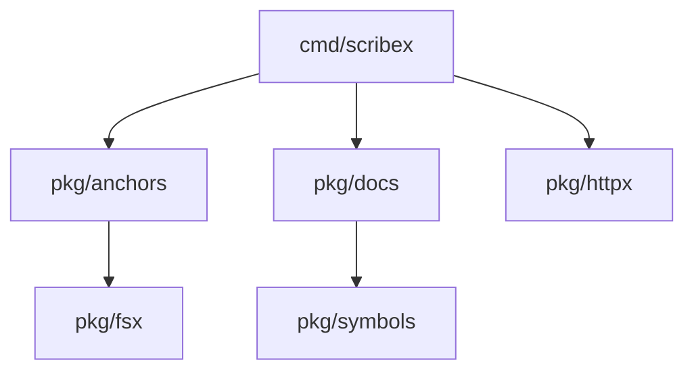

# In-Repo Markdown, Living Diagrams & Wikis Setup Guide

**Module:** `scribex-ai`  
**Platform:** Git Repositories, In-Repo Markdown, Mermaid.js & Static Site Generators (Docusaurus, MkDocs, VitePress, GitHub Wiki)  
**Audience:** Technical Writers, Core Engineers, Software Architects, Open Source Maintainers  
**Scope:** Anchor syntax, cryptographic signature blocks, living Mermaid diagrams, interlinked wikis, backlinks indexing, and static documentation site rendering.

---

## 1. Overview: The Power of In-Repo Documentation

The most reliable documentation lives right next to the code in the same git repository. It is reviewed in the same pull requests, versioned in the same branches, and audited in the same commits.

Scribex AI elevates in-repo Markdown into an active, compiled system through three capabilities:
1. **Code-to-Doc Anchors:** Cryptographically bounding Markdown sections to exact source code symbols.
2. **Living Architecture Diagrams:** Auto-generating Mermaid.js dependency graphs directly from Go AST package imports.
3. **Interlinked Wiki System:** Providing `[[Wikilinks]]`, orphan page detection, backlinks graphs, and automated rendering for GitHub Wiki or Static Site Generators.

---

## 2. In-Repo Code-to-Doc Anchors

Anchors allow you to embed dynamic code contracts inside standard Markdown files (`README.md`, `docs/*.md`, `docs/architecture/*.md`).

### 2.1 Anchor Syntax Specification

An anchor is represented by an HTML comment tag:

```markdown
<!-- @scribex:anchor(pkg/auth/jwt.go#VerifyToken) -->
### VerifyToken
Validates incoming JWT bearer tokens using the RS256 algorithm.

```signature
func VerifyToken(tokenString string, keyFunc jwt.Keyfunc) (*jwt.Token, error)
```
<!-- /@scribex:anchor -->
```

Or using the alternate closing delimiter `<!-- @scribex:end -->`.

### 2.2 Anchor Parameters

| Parameter | Required | Description | Example |
| :--- | :---: | :--- | :--- |
| **File Path** | Yes | Clean relative path from repository root (no leading slash, no `..`). | `pkg/auth/jwt.go` |
| **Symbol Name** | Yes | Separated from file path by a single `#`. Function, method, struct, or interface. | `#VerifyToken`, `#Server.ServeHTTP` |
| **`sig`** | Optional | 16-character hexadecimal cryptographic hash of the normalized signature. | `sig=a1b2c3d4e5f67890` |

### 2.3 Cryptographic Signature Digests (16-Hex vs 8-Hex)
- **Modern 16-Hex Hashes:** Scribex generates 16-character hexadecimal hashes representing the first 8 bytes of the SHA-256 digest of the normalized symbol signature.
- **Legacy 8-Hex Hashes:** Earlier Scribex versions used 8-character hashes. Scribex maintains backward compatibility: an 8-character hash matches if it is a prefix of the target symbol's 16-character hash.
- **Automatic Upgrade:** Running `scribex sync` automatically upgrades legacy 8-character hashes to 16-character hashes.
- **Line Ending Preservation:** Scribex detects whether your document uses UNIX (`\n`) or Windows (`\r\n`) line endings and preserves them byte-for-byte during signature rewrites.

---

## 3. Living Mermaid Architecture Diagrams (`scribex diagram`)

Maintaining architecture diagrams by hand is prone to immediate decay. Scribex scans your Go package dependencies and automatically synthesizes living Mermaid.js diagrams.

### 3.1 Adding Diagram Blocks to Documentation

Insert an empty diagram block into your `README.md` or architecture document:

```markdown
<!-- @scribex:diagram -->
```mermaid
graph TD
    %% Scribex will automatically populate this graph
```
<!-- /@scribex:diagram -->
```

### 3.2 Running the Diagram Generator

Execute:
```bash
scribex diagram
```

### 3.3 What Scribex Produces

Scribex parses package declarations and import paths across all Go files, prunes external third-party dependencies, and formats internal package relationships into a clean, hierarchical graph:

```markdown
<!-- @scribex:diagram -->

<!-- /@scribex:diagram -->
```

Run `scribex diagram` in your CI pipeline on merge to keep architecture diagrams continuously synchronized with live imports.

---

## 4. Scribex Wiki Engine (`docs/wiki/`)

Scribex includes a built-in wiki engine for maintaining connected technical documentation meshes.

### 4.1 Configuration in `.scribex/config.yaml`

```yaml
version: "1.0"
wiki:
  dir: docs/wiki          # Root directory for wiki pages
  home: Home              # Root entrypoint page name (Home.md)
```

### 4.2 Creating New Wiki Pages

```bash
scribex wiki new "Authentication Architecture"
```

Creates `docs/wiki/authentication-architecture.md` with standardized frontmatter:

```markdown
---
title: Authentication Architecture
tags: []
---

# Authentication Architecture

Enter documentation here.
```

### 4.3 Wikilinks Syntax & Resolution Rules

- **Standard Wikilink:** `[[Getting Started]]` links to `getting-started.md`.
- **Custom Display Label:** `[[Getting Started|Begin Here]]` displays as *"Begin Here"*.
- **Fuzzy Normalization:** Wikilinks are case-insensitive, space-insensitive, and hyphen-insensitive:
  - `[[Getting Started]]`, `[[getting-started]]`, `[[getting started]]`, and `[[GETTING_STARTED]]` all resolve to the same canonical file.

### 4.4 Wiki Quality Assurance: Linting & Broken Link Detection

Run:
```bash
scribex wiki lint
```

Scribex verifies the integrity of your wiki mesh and reports:
1. **Broken Links:** Wikilinks pointing to non-existent documents.
2. **Duplicate Titles:** Two documents sharing identical normalized names.
3. **Orphan Pages:** Documents that have zero inbound links and cannot be reached from `Home.md`.

Exits with code `1` if issues are discovered, making it an ideal pre-commit or CI gate.

### 4.5 Backlinks & Inverted Search

```bash
# Query all pages that link to a given document:
scribex wiki backlinks "Authentication Architecture"
# Output:
# docs/wiki/getting-started.md
# docs/wiki/api-reference.md

# Search wiki content across all pages:
scribex wiki search "JWT token"
# Output:
# docs/wiki/authentication-architecture.md:32: Validates incoming JWT bearer tokens
```

---

## 5. Publishing to Static Documentation Portals & GitHub Wiki

### 5.1 Exporting to GitHub Wiki (`.wiki.git`)

GitHub provides a separate git repository for project wikis (`https://github.com/owner/repo.wiki.git`).

Use `scribex wiki render` to compile the wiki:

```bash
# 1. Clone the GitHub Wiki repository:
git clone https://github.com/owner/repo.wiki.git ../repo.wiki

# 2. Render internal wikilinks into GitHub Wiki compatible format:
scribex wiki render -out ../repo.wiki

# 3. Commit and push:
cd ../repo.wiki
git add .
git commit -m "docs: sync wiki from main repository"
git push origin master
```

**What `render` Does:**
- Resolves all `[[Wikilinks]]` into clean relative `.md` links.
- Automatically appends a `"Linked from:"` navigation footer on every page listing all backlinked documents.
- Synthesizes `Home.md` and `_Sidebar.md` for GitHub's sidebar navigation menu.

### 5.2 Integrating with Static Site Generators (Docusaurus / MkDocs / VitePress)

If your documentation portal is built using Docusaurus, VitePress, or MkDocs:
- Point `wiki.dir` to your docs content folder: e.g., `docs` or `content/docs`.
- Configure your build script to execute `scribex check` and `scribex wiki lint` prior to running `npm run build` or `mkdocs build`.
- This guarantees that static documentation builds fail if code signatures or documentation cross-links are broken.
