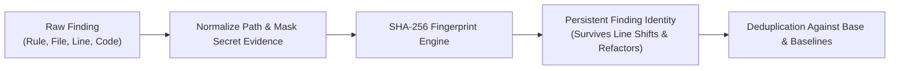
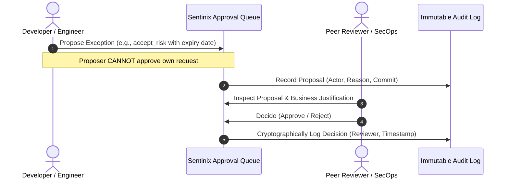

#  Sentinix AI: Conceptual Foundation & Defensive Principles

**Module:** `sentinix-ai`  
**Author:** Kolta Labs Security & Systems Engineering Group  
**Audience:** Security Architects, Engineering Directors, DevSecOps Engineers, Compliance Auditors  
**Scope:** Core philosophy, delta verification, content fingerprinting, separation of duties, and coverage transparency.

---

## 1. The Operational Failure of Traditional Scanners

Most software organizations do not lack security tooling; they suffer from scanner fatigue. The typical adoption lifecycle follows a predictable failure curve:

1. **The Day-One Tsunami:** A commercial static analysis tool (SAST) is introduced to an active codebase. It generates hundreds of alerts, the vast majority representing harmless syntactic patterns, third-party libraries, or deliberate internal architectures.
2. **The Triage Impasse:** The security team triages the initial findings, while developers are forced to manually mark items as ignored. As feature deadlines approach, the scanner output devolves into background noise.
3. **Safeguard Erosion:** To keep CI green, teams silently loosen rules, disable severity levels, or grant global exemptions. When a critical zero-day or hardcoded secret actually enters the tree, it passes unnoticed in the deluge.
4. **Context Blindness:** Standard scanners analyze files in isolation without understanding the *direction of change*. A developer editing a 5-line CSS change is blamed for an unencrypted SQLite query written five years prior in an adjacent module.

```
Conventional Scanners:      Whole-repo dump ──► 500 alerts ──► Ignored ──► Safeguard decay
Sentinix Architecture:      PR Delta Scan   ──► New issues only ──► Verified Gate ──► Audited Fix
```

Sentinix AI was designed from the ground up to solve this operational breakdown.

---

## 2. Core Epistemic Principles

### 2.1 The Change-Delta Paradigm (Head vs. Base)
Sentinix fundamentally evaluates changes, not legacy debt:
* Every Pull Request / Merge Request is shallow-fetched against its upstream base branch.
* Scanning engines evaluate both the PR head commit and the base commit in isolated throwaway workspaces.
* **Invariant:** Only vulnerabilities introduced by *the active change* are presented to the developer or applied against the gating threshold.
* Developers are never blocked by pre-existing technical debt they did not create. Existing issues are tracked on the centralized dashboard for scheduled technical debt remediation, removing developer hostility toward security tooling.

### 2.2 Content-Based Fingerprinting Over Line References
Traditional linters and code-scanning databases link alerts to physical line numbers (`file.kt:42`). A refactoring that inserts ten lines at the top of the file invalidates the entire database, causing tools to report "new" alerts and breaking baselines.

Sentinix computes an immutable cryptographic fingerprint for every finding:

$$\text{Fingerprint} = \text{HMAC-SHA256}\Big(\text{RuleID} \parallel \text{CanonicalPath} \parallel \text{NormalizedMaskedEvidence}\Big)$$

Because the identity depends strictly on the vulnerability rule, the relative file path, and the semantic code evidence (with secrets masked), a finding preserves its identity across file edits, line shifts, and variable renames.



### 2.3 Epistemic Honesty: The Coverage Statement
Security tools frequently create a false sense of safety: if a scanner reports zero findings, stakeholders assume the code is secure. In reality, a scanner may have reported zero findings because an engine failed, an unsupported framework was used, or the binary crashed silently.

Sentinix mandates a **Cryptographic Coverage Statement** on every output (CLI logs, PR comments, and executive reports):
* It explicitly enumerates every engine and rule pack version that executed.
* It explicitly declares what was **not covered** (e.g., uninstalled optional binaries, unparsed targets, non-configured dependency channels).
* **Fail-Closed Guarantee:** If an engine fails during a scan, Sentinix exits with error code `3`. A crashed scanner is never presented as a clean bill of health.

### 2.4 Governance & Separation of Duties (No Grading Your Own Homework)
Security configurations degrade when individual contributors under deadline pressure are allowed to weaken safeguards unilaterally. 

Sentinix enforces a strict two-person separation of duties protocol for:
1. **Risk Acceptance (`accept_risk`):** Accepting a known finding as an authorized business risk.
2. **Rule Disabling (`disable_rule`):** Turning off an inspection rule across a project.
3. **Severity Loosening (`loosen_severity`):** Lowering a rule's severity to bypass branch protection.



Any exception requires a mandatory expiration TTL (Time-To-Live). When the TTL expires, the exception lapses and the finding automatically reopens on the next scan, preventing temporary waivers from becoming permanent vulnerabilities.

---

## 3. The Dual-Tier System Architecture

Sentinix separates deterministic static analysis from speculative AI reasoning:

| Architectural Tier | Execution Mode | Technology Stack | Characteristics |
| :--- | :--- | :--- | :--- |
| **Tier 1: Core Engine** | Deterministic | Pure Go 1.23+, AST matching, Regex, SARIF normalizers | • 100% reproducible results.<br>• Zero external network requests.<br>• Sub-second execution speeds.<br>• Operates entirely in air-gapped environments.<br>• Authoritative PR merge gate. |
| **Tier 2: Advisory AI Council** | Non-Deterministic | OpenAI-compatible LLM endpoints (Local Ollama, Gemini, DeepSeek, Claude) | • Strictly advisory; cannot unilaterally dismiss findings.<br>• Multi-model consensus deliberation.<br>• Automated unified patch drafting.<br>• Verified sandbox test generation. |

By restricting the automated merge gate entirely to Tier 1, builds remain fast, reproducible, and immune to non-deterministic model hallucinations. Tier 2 serves as an intellectual force-multiplier for human security reviewers during triage.
