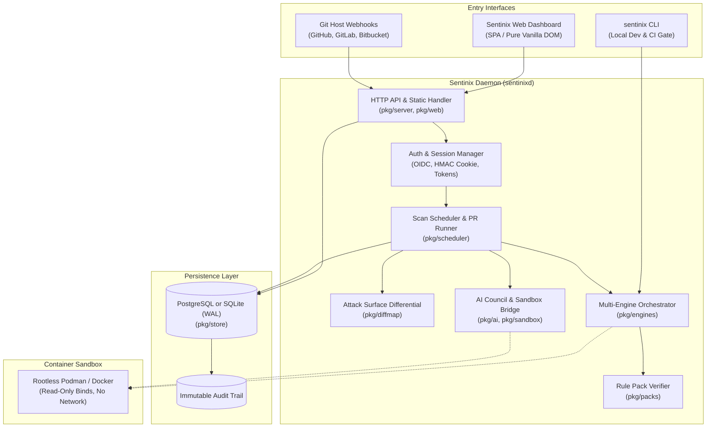
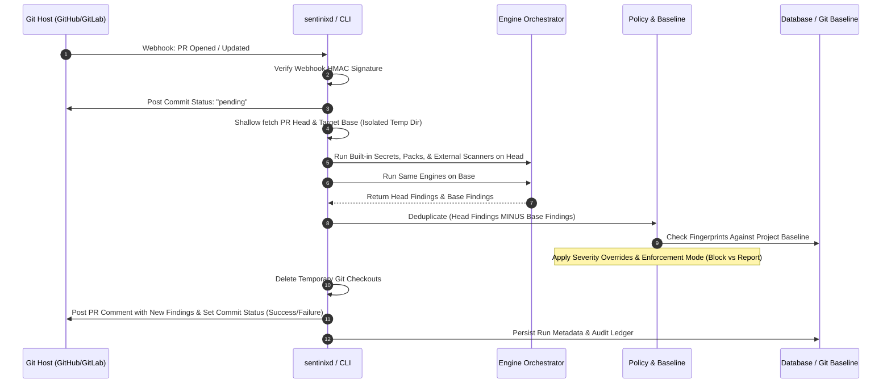
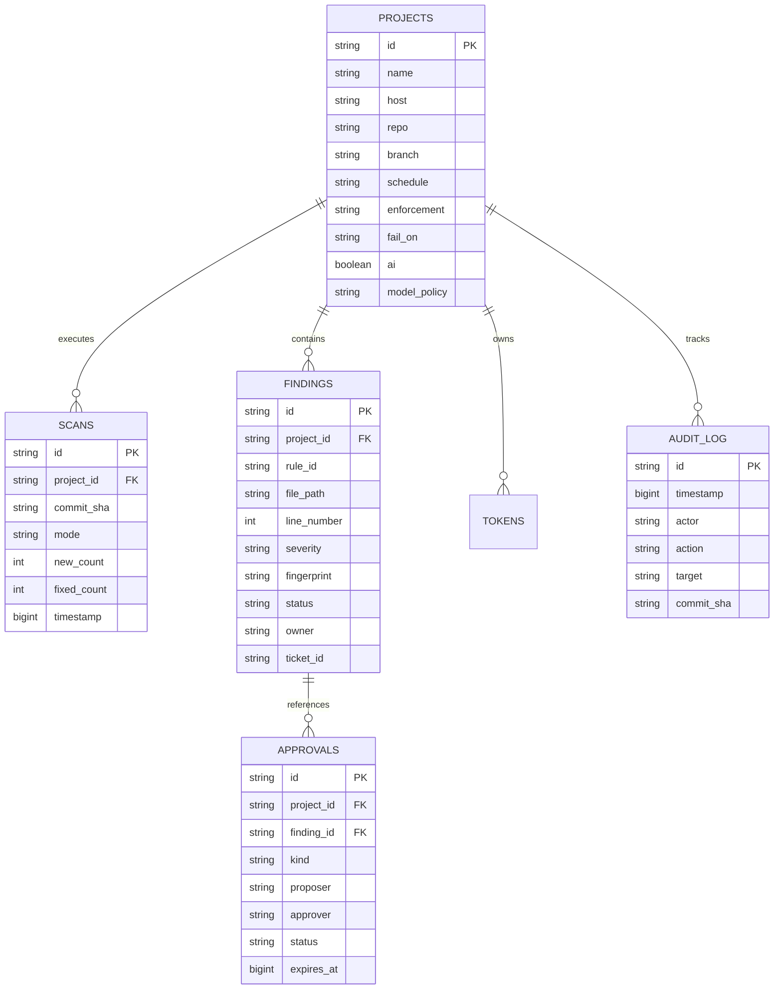

# Sentinix AI: Core Technical Architecture & Security Model

**Module:** `sentinix-ai`  
**Author:** Keltstone Systems Security & Systems Engineering Group  
**Audience:** Principal Architects, Security Engineers, Infrastructure Leads  
**Scope:** Component topologies, data flow lifecycles, database schemas, cryptographic isolation, and sandbox runtime contracts.

---

## 1. System Topology & Component Map

Sentinix AI is structured as a modular Go codebase with a clean separation between stateless inspection routines and stateful governance services.



### Component Directory Reference

| Component Path | Functionality | Key Interfaces & Dependencies |
| :--- | :--- | :--- |
| `cmd/sentinix` | Standalone CLI utility. Executes local scans, diff surfaces, rule pack keygen/signing, and offline benchmark validation. | Pure Go; zero network requirements unless OSV endpoint is configured. |
| `cmd/sentinixd` | Long-running daemon. Provides Git webhooks, HTTP REST API, cron scheduling, and web UI. | Exposes port `:8080` (configurable); connects to SQLite or PostgreSQL. |
| `pkg/engines` | Unified scanner abstractions. Runs built-in regex secrets scanner, signed rule packs, and wrappers for `gitleaks`, `semgrep`, and `osv-scanner`. | Normalizes disparate third-party formats into unified `Finding` structures. |
| `pkg/packs` | Ed25519 cryptographic rule pack loader. Loads, verifies signatures, and executes Kotlin, Android, and KMP rule packs. | Ensures rule packs cannot contain executable payloads. |
| `pkg/githost` | Multi-provider API abstraction for GitHub, GitLab, and Bitbucket Cloud. | Manages comment threading, check statuses, and webhook payload signature verification. |
| `pkg/scheduler` | Isolated scan orchestrator. Manages shallow clones, branch comparisons, concurrency worker pools, and baseline deduplication. | Cleans up all working trees immediately upon completion. |
| `pkg/store` | Unified SQL persistence layer supporting both SQLite (with WAL mode) and PostgreSQL. | Implements automatic schema initialization and non-destructive migrations. |
| `pkg/diffmap` | Attack surface extraction engine. Analyzes unified diffs to detect newly declared permissions, routes, and dependencies. | Uses language-specific AST and lexical boundary parsing. |
| `pkg/ai` | Multi-model deliberation council, patch synthesizer, and prompt injection defense wrapper. | Compatible with any OpenAI-style chat completion API. |
| `pkg/sandbox` | Hardened container execution boundary for running untrusted scanners or AI-generated tests. | Drops all Linux capabilities; mounts code as read-only; denies network access. |

---

## 2. Scan Execution Pipeline (Data Flow)

Every scan—whether triggered by a git webhook, a CI upload, a schedule, or a local developer—follows a strict, deterministic six-stage lifecycle:

```
[Trigger] ──► [Surface Map] ──► [Engines] ──► [Policy Engine] ──► [AI (Optional)] ──► [Reporting & Gate]
```



### Detailed Pipeline Stages

1. **Trigger & Signature Verification:**
   * Inbound HTTP webhooks are validated using HMAC-SHA256 (`X-Hub-Signature-256` for GitHub, `X-Gitlab-Token` for GitLab).
   * Unauthenticated or unsigned requests are immediately rejected before spawning work.
2. **Ephemeral Shallow Workspace:**
   * The scheduler creates a dedicated scratch directory with strict filesystem permissions (`0700`).
   * The target commit is shallow-fetched (`--depth=1`). Git credentials are used solely during the fetch phase and scrubbed from all environment variables and memory.
3. **Multi-Engine Normalization:**
   * All configured engines run concurrently up to the worker limit.
   * Discovered vulnerabilities are mapped into standard normalized fields: `RuleID`, `FilePath`, `LineNumber`, `Severity`, `Title`, `Evidence` (with secrets masked), `CWE`, and `OWASP`.
4. **Policy & Change Deduplication:**
   * Findings existing on the base branch are pruned. Only findings introduced by *this specific commit* remain.
   * If a baseline file (`.sentinix-baseline.json`) is configured, existing baseline fingerprints are subtracted.
5. **Advisory AI Council (Optional):**
   * If enabled, findings of `medium` severity or higher are dispatched to the AI Council for false-positive evaluation and patch generation.
6. **Reporting & Gate Verdict:**
   * If any remaining finding meets or exceeds the project's `fail_on` severity threshold, and `enforcement` is set to `block`, the check status fails, blocking merge.
   * If `enforcement` is set to `report`, the status passes with an informational warning.

---

## 3. Storage Architecture & Schemas

The persistence layer (`pkg/store`) is completely database-agnostic, functioning identically on embedded **SQLite** (with Write-Ahead Logging enabled) and high-concurrency **PostgreSQL 14+**.



### Table Specifications

* **`projects`**: Configures registered Git repositories, execution schedules, gating policies, and AI permissions.
* **`findings`**: Stores normalized vulnerabilities. Identity is anchored on `fingerprint`. Status tracks `open`, `fixed`, `accepted`, or `false_positive`.
* **`scans`**: Historical ledger of every full scan or PR review, recording duration, engines executed, and delta metrics.
* **`approvals`**: Holds pending governance proposals (`accept_risk`, `disable_rule`, `loosen_severity`). Enforces that `proposer != approver`.
* **`audit_events`**: Append-only log recording all user and automated actions. Cannot be altered or pruned via API.

---

## 4. Security & Isolation Architecture

Because Sentinix ingests and parses untrusted source code from arbitrary branches, the system itself is hardened as a security-critical boundary.

### 4.1 Sandboxed Container Execution Contract
When external engines (such as Semgrep) or AI-generated verification tests run, they execute inside an isolated container boundary (`pkg/sandbox`):

```bash
podman run --rm \
  --network none \
  --cap-drop ALL \
  --security-opt no-new-privileges \
  --user 10001:10001 \
  --read-only \
  --tmpfs /tmp:rw,noexec,nosuid,size=64m \
  --volume /tmp/scratch:/src:ro \
  --memory 2g \
  --cpus 2.0 \
  sentinix-scanner:latest
```

* **Zero Network Egress:** `--network none` guarantees that malicious code in a repository cannot exfiltrate secrets or establish reverse shells during analysis.
* **Dropped Capabilities:** Every Linux kernel capability is stripped (`--cap-drop ALL`).
* **Read-Only Code Mount:** Source files are mounted `:ro`. Scanners cannot modify repository trees during analysis.
* **No Docker Socket Access:** The host Docker socket is never mounted inside worker containers, preventing container breakout attacks.

### 4.2 Web Security & Cross-Site Defenses
The web dashboard (`pkg/web`) is deliberately designed without heavy third-party JavaScript frameworks, build tooling, or external CDNs:
* **Strict Content Security Policy (CSP):** `default-src 'self'; script-src 'self'; style-src 'self' 'unsafe-inline'; object-src 'none'; frame-ancestors 'none';`
* **Zero `eval()` or `innerHTML`:** All dynamic DOM nodes are constructed using native `document.createElement()` and `textContent` assignments, eliminating DOM-based Cross-Site Scripting (XSS).
* **Anti-CSRF Invariant:** All state-changing API endpoints (`POST`, `PUT`, `PATCH`, `DELETE`) require the custom header `X-Requested-With: sentinix`. Browsers will not send custom headers across origins without explicit preflight authorization.
* **Session Cookie Hardening:** Authentication cookies are marked `HttpOnly`, `SameSite=Lax`, and `Secure` (unless `SENTINIX_INSECURE_COOKIES=1` is explicitly set for local localhost testing).

### 4.3 Cryptographic Rule Pack Verification
Custom rule packs are signed using **Ed25519** asymmetric cryptography:
* Rule authors generate keys via `sentinix packs keygen`.
* Packs are signed using `sentinix packs sign <manifest.json> <private.key>`. The command automatically executes the pack's internal test fixtures and refuses to sign any pack with failing tests.
* The daemon or CLI validates the signature against trusted public keys (`-trust public_keys.json`) before loading rules into the AST engine.
* Rule packs are purely declarative JSON/YAML structures; they contain zero executable code.
