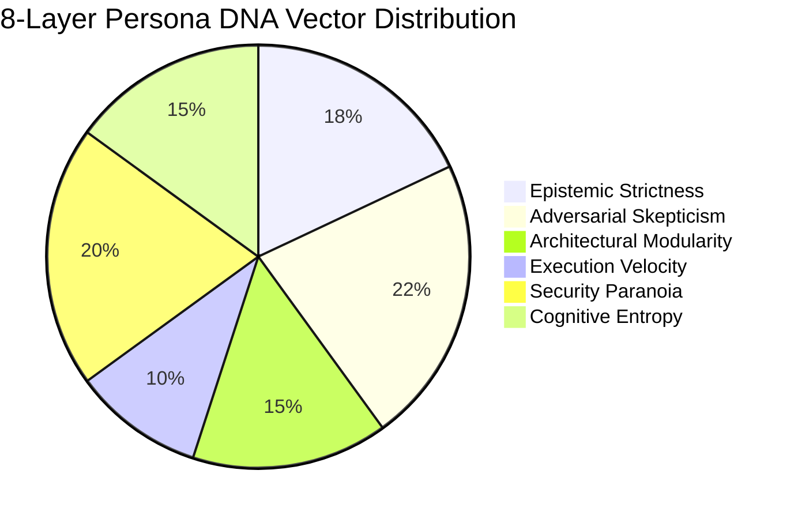

# Socratix Engine: Conceptual Foundation & Epistemology

**Engine:** `socratix-engine` (Go 1.27)  
**Author:** Keltstone Systems Research Group  
**Audience:** AI Researchers, Systems Architects, Epistemic Logicians, Prospective Developers  
**Scope:** Epistemology of multi-agent debate, Hegelian dialectics, anti-sycophancy theory, and paraconsistent logic.

---

## 1. The Epistemological Failure of Single LLMs

Every modern frontier Large Language Model (whether GPT-4o, Claude 3.5 Sonnet, Gemini 2.0, or DeepSeek R1) suffers from four systemic epistemic vulnerabilities when acting as a solo decision-maker:

### 1.1 The Sycophantic Echo Chamber
Frontier models are trained via Reinforcement Learning from Human Feedback (RLHF). Because human evaluators exhibit cognitive confirmation bias, reward models systematically reward outputs that agree with the prompt's premise. If a developer asks: *"Why should we rewrite our monolith in Rust microservices?"*, a solo LLM generates an articulate 10-page justification, downplaying operational overhead, network latency, distributed transaction complexity, and hiring costs.

### 1.2 Plausible Hallucination & Parametric Blind Spots
When an LLM lacks ground truth on an edge case, it does not output *"I don't know"*; it fabricates plausible-sounding APIs, libraries, or architectural patterns with high linguistic confidence. Without an adversarial agent reviewing the claim, this hallucination passes undetected into production design docs.

### 1.3 Mode Collapse in Complex Trade-offs
In multi-objective optimization (e.g. Latency vs. Throughput vs. Cost vs. Security), a single prompt collapses the solution space into whatever vector was emphasized latest in the prompt context. It cannot maintain adversarial tension between contradictory engineering requirements simultaneously.

---

## 2. Hegelian Dialectics: Thesis, Antithesis, Synthesis

Socratix Engine solves single-model bias by operationalizing **Hegelian Dialectics** into a deterministic state machine:

```
          ┌──────────────────────────────────────────────────────────────┐
          │                      STAGE 1: THESIS                         │
          │  Primary Model asserts architectural proposal & premises      │
          └──────────────────────────────┬───────────────────────────────┘
                                         │
                                         ▼
          ┌──────────────────────────────────────────────────────────────┐
          │                    STAGE 2: ANTITHESIS                       │
          │  Adversarial Secondary Models falsify assumptions, locate    │
          │  single points of failure, and introduce counter-evidence    │
          └──────────────────────────────┬───────────────────────────────┘
                                         │
                                         ▼
          ┌──────────────────────────────────────────────────────────────┐
          │               STAGE 3: DIALECTIC TENSION ISOLATION           │
          │  Engine isolates explicit Contradiction Pairs (A vs. ¬A)     │
          │  Paraconsistent Invariant: No premature consensus allowed    │
          └──────────────────────────────┬───────────────────────────────┘
                                         │
                                         ▼
          ┌──────────────────────────────────────────────────────────────┐
          │                     STAGE 4: SYNTHESIS                       │
          │  Moderator synthesizes higher-order resolution:              │
          │  Either reconciles both claims or logs an accepted trade-off  │
          └──────────────────────────────────────────────────────────────┘
```

1. **Thesis**: A participant (e.g. Claude 3.5 Sonnet acting as Distributed Systems Architect) articulates a technical position with foundational axioms.
2. **Antithesis**: Opposing participants (e.g. GPT-4o acting as Site Reliability Engineer, Gemini acting as Security Auditor) actively hunt for contradictions, latent edge-case failures, unbudgeted latencies, and security vulnerabilities.
3. **Dialectic Tension**: The engine extracts exact assertion pairs:
   $$\text{Thesis} \iff \text{Statement}_A \quad \text{vs.} \quad \text{Antithesis} \iff \text{Statement}_B$$
   The engine marks this contradiction in the **Tension Registry** (`pkg/consensus/detector.go`).
4. **Synthesis**: The debate does not terminate via mere majority vote. Either the participants formulate a hybrid design that satisfies both constraints, or the moderator records an **Accepted Trade-Off** with explicit risk bounds.

---

## 3. Cognitive Diversity & Cognitive Priors (8-Layer Persona DNA)

Putting three instances of the same model in a room creates an artificial illusion of agreement. Socratix Engine enforces genuine diversity through **heterogeneous cognitive priors**:



Each participant seat is configured with an **8-Layer Persona DNA** (`socratix-engine/pkg/model/persona_dna.go`):
1. **Model Substrate Diversity**: Mixing distinct model architectures (Anthropic Claude, OpenAI GPT, Google Gemini, DeepSeek R1, Local Llama/Qwen).
2. **Systemic Strictness**: Tolerance for ambiguity vs. demand for mathematical rigor.
3. **Skepticism Index**: Likelihood of challenging opposing premises without proof.
4. **Modularity / Layer Isolation**: Dedication to Clean Architecture boundaries.
5. **Operational Paranoia**: Assumption of Byzantine network failures, hostile tenants, and hardware crashes.
6. **Velocity vs. Correctness Weight**: Willingness to incur technical debt for rapid time-to-market.
7. **Empirical Grounding Threshold**: Refusal to accept claims without benchmark citations or attached code proof.
8. **Communication Style Vector**: Ranging from dense, zero-fluff engineering commands (`caveman`) to executive business trade-offs (`ponytail`).

---

## 4. The Socratic Method: Ruthless Elenchus

In addition to Council debates, Socratix Engine provides a **1-on-1 Socratic Interview Mode** (`pkg/socratic`):
- Rather than providing answers, the engine acts as an inquisitor executing the **Elenchus** (classical Socratic falsification).
- It identifies unstated assumptions in the user's premise and challenges them through 5 progressive stages:
  1. `HYPOTHESIS_EXTRACTION`: Isolates the core claim from user input.
  2. `ASSUMPTION_SURFACING`: Extracts hidden dependencies (e.g., assuming zero network latency).
  3. `ELENCHUS_STRESS_TESTING`: Subjects the premise to extreme counter-examples and boundary conditions.
  4. `APORIA_RECONCILIATION`: Forces the participant to confront philosophical or technical impasses.
  5. `MAIEUTIC_HARDENING`: Crystallizes the surviving axioms into a bulletproof specification.

---

## 5. Epistemic Guardrails: The Anti-Fluff Directive

To prevent models from descending into conversational politeness or conversational filler, the engine injects non-negotiable deliberation directives (`consensusDirective`):

```text
[DELIBERATION CONVERGENCE RULES]
1. If the arguments presented by other participants have resolved the core contentions
   and you have no substantially new empirical data, theoretical models, or counter-arguments to introduce:
   - Begin your reply immediately with the single token: AGREED:
   - Provide a concise 2-4 sentence summary explaining why you concur.
2. DO NOT artificially prolong the debate if consensus is reached.
3. DO NOT concede simply to end the debate if you still have an unaddressed factual, ethical, or logical objection.
```

- **No Pleasantries**: Greetings, apologies, compliments, and conversational padding are penalized or stripped.
- **Direct Refutation**: Agents must address opponents by name (`@Agent`) and attack specific technical clauses.
- **Paraconsistent Consensus Invariant**: A debate **cannot** conclude with consensus if open contradiction pairs remain unresolved in the engine's tension registry.

---

*Next: Continue to [Socratix Engine: Core Technical Architecture](../socratix-engine/02_CORE_TECHNICAL_ARCHITECTURE.md).*
