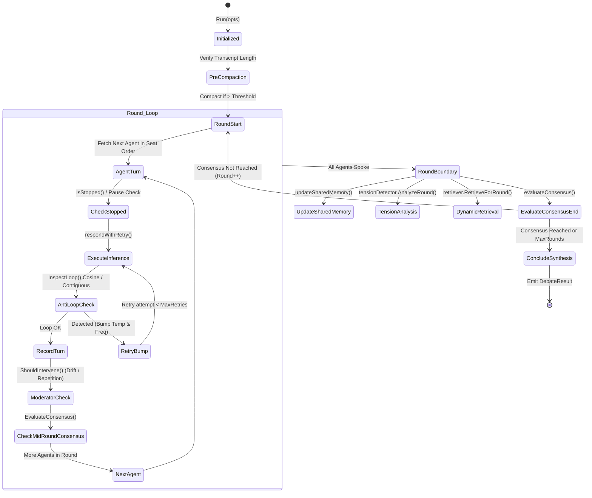

# Socratix Engine: Core Technical Architecture & Internals

**Engine:** `socratix-engine` (Go 1.27)  
**Author:** Kolta Labs Core Systems Architecture  
**Audience:** Core Engine Contributors, Systems Engineers, Evaluators  
**Scope:** Concurrency models, state machine transitions, mathematical formulas, algorithms, and package-by-package analysis.

---

## 1. Engine Package Architecture

The `socratix-engine` repository is organized into cleanly decoupled packages with zero cyclic imports:

```text
socratix-engine/
├── cmd/
│   ├── socratix/          # Main HTTP/SSE daemon entrypoint
│   ├── socratixbench/     # Benchmark evaluation runner
│   └── roundtable/        # Interactive multi-model terminal runner
└── pkg/
    ├── orchestrator/      # Round-robin turn loop, context compaction, retry logic
    ├── consensus/         # Stance evaluation, contradiction detector, paraconsistent logic
    ├── credence/          # Bayesian credence updating, Shannon entropy, tipping points
    ├── graph/             # SQLite WAL knowledge graph with Hebbian reinforcement & decay
    ├── retrieval/         # Round-aware dynamic RAG retriever
    ├── socratic/          # 1-on-1 Socratic interview engine & Elenchus digest
    ├── runner/            # AgentRunner interface: CLI runner & direct API runner
    ├── persona/           # 8-layer persona compiler, validator, and built-ins
    ├── decomposition/     # Problem decomposition into sub-claims and decision axes
    ├── benchmark/         # Null-hypothesis benchmark harness & Dialex-Bench-10
    ├── store/             # SQLite database persistence & AES-256-GCM keyring
    ├── api/               # REST HTTP handlers, SSE streamer, audit logger, tsnet
    └── model/             # Shared domain data models, contracts, and enums
```

---

## 2. Turn State Machine & Orchestrator Loop

The core orchestration engine lives in [`pkg/orchestrator/orchestrator.go`](../../socratix-engine/pkg/orchestrator/orchestrator.go). It drives turn-by-turn execution independent of transport or storage.



### Key Orchestrator Features

1. **Context Compaction (`maybeCompact`)**:
   - Resending transcripts verbatim across 10 rounds causes token explosion.
   - When message count exceeds `compactThreshold` (default: 20), messages older than `compactKeepRecent` (default: 8) are summarized by the primary model into a high-density summary block.
   - **Request-Shaping Invariant**: Compaction applies *only* to what is passed over the wire to model APIs; the persisted SQLite transcript, caller SSE streams, and resume math always retain 100% verbatim history.
2. **Dynamic Anti-Loop Detection (`InspectLoop`)**:
   - Detects when agents get trapped in conversational loops or repeat verbatim arguments.
   - Uses contiguous duplicate character scanning and cosine similarity thresholds.
   - Automatically bumps model temperature ($+0.15$) and frequency penalty on retry.
3. **Graceful Turn Interruption Recovery (`handleTurnFailureGracefully`)**:
   - If a provider drops connection or times out late in a debate (e.g. Round 4), the orchestrator does **not** fail the entire session.
   - If at least one complete round succeeded, the moderator performs an **Emergency Synthesis**, wrapping up the established arguments and marking the failure gracefully.

---

## 3. Contradiction Detection & Paraconsistent Invariant

In [`pkg/consensus/detector.go`](../../socratix-engine/pkg/consensus/detector.go), Socratix implements a **Paraconsistent Contradiction Detector**:

```mermaid
flowchart TD
    RoundTurns["Round Turns Transcript"] --> ModelPass["Dialectic Analyzer Pass (LLM / Heuristic)"]
    ModelPass --> NewTensions["Extract New Tensions (Thesis vs Antithesis)"]
    ModelPass --> ResolvedTensions["Check Existing Tensions for Resolution"]
    
    NewTensions --> TensionRegistry[("Tension Registry<br/>model.TensionPair")]
    ResolvedTensions --> TensionRegistry
    
    TensionRegistry --> InvariantCheck{"Are there OPEN or<br/>EXPLORED Tensions?"}
    InvariantCheck -->|Yes| BlockConsensus["Block Consensus!<br/>Emit 'Superficial Consensus Detected'<br/>Force next round or log trade-off"]
    InvariantCheck -->|No (All Resolved/Accepted)| AllowConsensus["Allow Consensus Convergence"]
```

### Data Schema (`model.TensionPair`)
```go
type TensionPair struct {
    ID                 string          `json:"id"`
    Thesis             AgentAssertion  `json:"thesis"`
    Antithesis         AgentAssertion  `json:"antithesis"`
    UnderlyingConflict string          `json:"underlyingConflict"` // e.g. "ACID Quorum vs Write Latency"
    Status             TensionStatus   `json:"status"`             // OPEN, EXPLORED, RESOLVED, ACCEPTED_TRADE_OFF
    Severity           float64         `json:"severity"`           // [0.0, 1.0]
    Synthesis          *string         `json:"synthesis,omitempty"`
    TradeOffRationale  *string         `json:"tradeOffRationale,omitempty"`
    DetectedInRound    int             `json:"detectedInRound"`
    ResolvedInRound    *int            `json:"resolvedInRound,omitempty"`
}
```

### The Paraconsistent Consensus Invariant
```go
func (o *Orchestrator) evaluateConsensus(curRound int) (bool, float64) {
    result := consensus.Evaluate(curRound, transcript, config)
    if !result.Achieved {
        return false, result.Ratio
    }
    // Paraconsistent Invariant: cannot conclude consensus if active tensions remain!
    if model.HasOpenTensions(currentTensions) {
        currentTensions = tensionDetector.HeuristicAnalyzeRound(config.Topic, curRound, curRoundMessages, currentTensions)
        if model.HasOpenTensions(currentTensions) {
            return false, result.Ratio // Block early stopping!
        }
    }
    return true, result.Ratio
}
```

---

## 4. Bayesian Credence Tracking & Information Theory

Implemented in [`pkg/credence/tracker.go`](../../socratix-engine/pkg/credence/tracker.go), Socratix models deliberation as a Bayesian belief updating process over a discrete hypothesis space $\{H_1, H_2, \dots, H_K\}$.

### Mathematical Formulations

#### 1. Shannon Epistemic Entropy
The system measures the uncertainty / disagreement of the council at round $r$:
$$S(r) = - \sum_{k=1}^K p(H_k \mid r) \log_2 p(H_k \mid r)$$
- Uniform distribution (maximum disagreement): $S_{\max} = \log_2(K)$.
- Complete convergence: $S \to 0$.

#### 2. Weighted Linear Pooling of Persona Credence
Individual persona credence distributions $p_i(H_k)$ are aggregated using weights derived from their **8-Layer Persona DNA**:
$$p(H_k) = \frac{\sum_{i=1}^M w_i \cdot c_i \cdot p_i(H_k)}{\sum_{i=1}^M w_i \cdot c_i}$$
where $w_i$ is the persona domain authority weight and $c_i \in [0, 1]$ is the persona's self-assessed certainty score.

#### 3. Likelihood Ratio & Tipping Point Detection
When an agent or council shifts credence between round $r-1$ and $r$ by $\ge 15\%$, the engine calculates the **Bayes Factor / Likelihood Ratio** $\Lambda$:
$$\Lambda = \frac{p(H_A \mid r) \cdot p(H_B \mid r-1)}{p(H_B \mid r) \cdot p(H_A \mid r-1)}$$
The engine extracts the exact piece of retrieved evidence or argument that triggered this shift and records a `TippingPoint` event.

---

## 5. Local Knowledge Graph & Hebbian Reinforcement

Implemented in [`pkg/graph/sqlite.go`](../../socratix-engine/pkg/graph/sqlite.go), the engine maintains a local SQLite graph database storing propositions, arguments, tensions, and deliverables.

### Hebbian Edge Reinforcement
When an argument or concept successfully supports or counters another node across multiple rounds, the edge strength is reinforced according to Hebbian learning rules:
$$E_{new} = E_{old} + \eta \cdot (1.0 - E_{old})$$
where $\eta \in (0, 1]$ is the reinforcement rate (default: $0.2$).

### Exponential Epistemic Time Decay
Unreferenced nodes and stale arguments decay exponentially over time:
$$W(t) = W_0 \cdot 2^{-\frac{t - t_0}{\lambda}}$$
where $\lambda$ is the decay half-life in seconds (default: 7 days).
- Nodes that decay below a minimum threshold ($W < 0.10$) are automatically pruned during database maintenance cycles.

---

## 6. Model Runners: CLI vs. API

In [`pkg/runner/`](../../socratix-engine/pkg/runner), Socratix abstracts AI inference behind the unified `AgentRunner` interface:

```go
type AgentRunner interface {
    Respond(
        ctx context.Context,
        agent model.Agent,
        topic, commonContext, commonInstructions string,
        transcript []model.DebateMessage,
        modelOverride string,
    ) (AgentReply, error)
}
```

1. **`ApiRunner` (`api_runner.go`)**: Direct HTTP calls to OpenAI, Anthropic, Google Gemini, DeepSeek, Grok, and Ollama. Implements streaming response parsing, rate-limit backoff, and token usage accounting.
2. **`CliRunner` (`cli_runner.go`)**: Drives developer CLI subshells (`claude -p`, `codex exec`, `agy run`). Reads user credentials directly from developer seats, incurring **\$0 extra token billing**.

---

*Next: Continue to [Socratix Engine: User Guide & Operations](../socratix-engine/03_USER_GUIDE_AND_OPERATIONS.md).*
