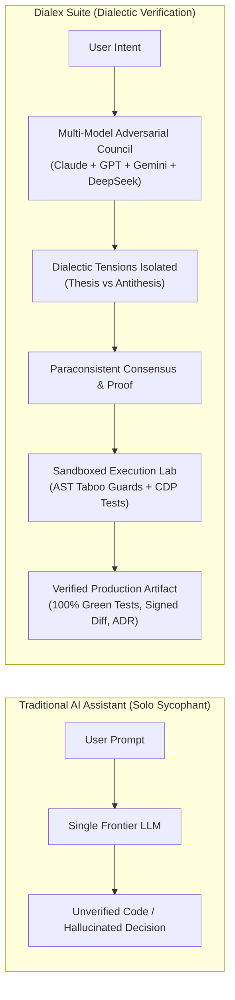
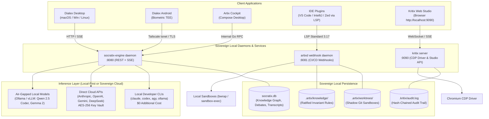

# Dialex Suite: Ecosystem Architecture & System Design

**Author:** Kolta Labs Core Architecture Group  
**Audience:** Staff & Principal Engineers, Enterprise Architects, Technical Evaluators  
**Scope:** Holistic multi-engine architecture, interoperability contracts, design principles, and unified system topology.

---

## 1. Executive Summary & Core Philosophy

The fundamental limitation of generative AI in mission-critical software engineering and strategic decision-making is **epistemic sycophancy**: a single model, when prompted, attempts to validate its own assumptions, flatters the user's framing, invents plausible-sounding rationales, and masks blind spots.



**Dialex Suite** replaces the solo prompt-response paradigm with a **tripartite dialectic engine**:
1. **Adversarial Deliberation (`socratix-engine` & `dialex-ai`)**: Pits heterogeneous frontier models (different providers, parameter scales, and cognitive priors) against one another under an impartial moderator state machine.
2. **Autonomous Software Engineering (`artix-ai`)**: Decouples requirements planning from code execution into two separate checks-and-balances chambers, utilizing shadow git worktrees and sandboxed compilers to enforce non-negotiable architectural invariants (Taboo Spaces).
3. **Autonomous Quality & Verification (`kritix-ai`)**: Replaces wasteful brute-force DOM token dumping with native Go deterministic optimization (95% token compression), self-healing locators, OWASP DAST security fuzzers, and build-failing flaky test quarantine SLAs.

---

## 2. The Four Engines & Their Responsibilities

| Engine | Directory | Technology Stack | Primary Operational Mandate |
|---|---|---|---|
| **Socratix Engine** | [`socratix-engine/`](../../socratix-engine) | Go 1.27, SQLite (WAL mode), pure-Go HTTP/SSE | Central reasoning daemon: orchestrates round-robin turns, extracts dialectic tensions, tracks Bayesian credence across rounds, maintains the project knowledge graph, and interfaces with model runners. |
| **Dialex AI Client** | [`dialex-ai/`](../../dialex-ai) | Kotlin Multiplatform (KMP), Compose Multiplatform, SQLite / DataStore, Argon2id Vault | Cross-platform visual deliberation workbench (Desktop & Android). Delivers synthetic advisory boards, live human intervention, Socratic interviews, and generative deliverables (ADRs, decision matrices, executive memos). |
| **Artix AI Platform** | [`artix-ai/`](../../artix-ai) | Go 1.27 (CLI & `artixd`), Compose Desktop Cockpit, LSP 3.17 server | Autonomous software engineering platform: executes Chamber 1 (Stakeholder Council planning) and Chamber 2 (Isolated shadow worktrees with AST Taboo Reviewer and sandboxed compilers). |
| **Kritix AI Platform** | [`kritix-ai/`](../../kritix-ai) | Go 1.27 (CLI & server), CDP Driver, Compose Desktop Cockpit, Embedded Web Studio | Autonomous testing platform: token-optimized DOM pruning, multi-factor self-healing locators, active DAST security fuzzing, k6 load testing, flaky test quarantine SLAs, and SARIF/JUnit export. |

---

## 3. High-Level System Topology

Dialex Suite is built with a **decoupled, sovereign topology**. Client user interfaces never talk directly to AI vendor APIs; all communication is channeled through local or on-premise engine daemons.



---

## 4. Architectural Invariants Across All Engines

Every component across the Dialex Suite adheres to five non-negotiable architectural invariants:

### Invariant 1: Local-First and Zero-Cloud Data Sovereignty
- Credentials (API keys, OAuth tokens) never transit to any intermediary cloud server hosted by Kolta Labs.
- On macOS, keys reside in the **macOS Keychain Services**.
- On Linux, keys reside in **Secret Service API / secret-tool** with a fallback to `0600` encrypted file storage.
- On Android, keys reside in the **Android Keystore System** backed by a Hardware Security Module (TEE / StrongBox).
- Transcripts, knowledge graphs, test runs, and audit logs are stored exclusively in local SQLite databases (`WAL` mode) or local hash-chained log files.

### Invariant 2: Deterministic Go Native Algorithms Preempt LLM Calls
- Brute-force LLM context dumping is strictly prohibited.
- DOM simplification, HTML token compression, state hashing, regex assertions, TOTP MFA calculations, AST parsing, and diff comparisons run natively in compiled Go code ($< 1\text{ ms}$, **0 LLM tokens**).
- Model invocation occurs only when non-deterministic synthesis, subjective compromise, or creative hypothesis generation is mathematically required.

### Invariant 3: Clean Architecture & Unidirectional State Flow
- In Kotlin Multiplatform (`dialex-ai`): `ViewModel → UseCase → Repository (interface, domain) → RepositoryImpl → DataSource → Originator`. Domain contains zero platform imports. Presentation uses unidirectional MVI (`State`, `Intent`, `Effect`).
- In Go (`socratix-engine`, `artix-ai`, `kritix-ai`): Strict package boundaries with dependency inversion. No package cycles. Domain models are decoupled from HTTP transport and storage implementations.

### Invariant 4: Complete Execution Isolation
- Autonomous code modifications never touch the user's active Git working directory. Code generation and test execution occur in isolated **Shadow Git Worktrees** (`.artix/worktrees/<task-id>`).
- Test execution runs in sandboxes denying network access by default (`--offline`), using OS-level containment (`sandbox-exec` on macOS, `bwrap` on Linux).
- Active DAST security scanning and fuzzing enforce a strict **default-deny host allowlist** (`KRITIX_ALLOWED_TARGETS`).

### Invariant 5: Provable and Cryptographic Auditability
- In `kritix-ai`, all authorization events and test executions append to an HMAC-SHA256 signed, hash-chained ledger (`KRITIX_AUDIT_LOG`).
- In `artix-ai`, every generated patch carries cryptographic commit provenance and links to the canonical story specification (`docs/specs/STORY-<id>.md`).
- In `socratix-engine`, consensus is verifiable via mathematical convergence metrics (Shannon entropy, stance ratios, Bayesian likelihood ratios) rather than subjective sentiment.

---

## 5. Directory Layout & Monorepo Structure

```text
DialexAI/
├── docs/                      # Central Wiki Documentation Suite
│   ├── README.md              # Master Wiki Portal & Index
│   ├── suite-architecture/    # Global Ecosystem Architecture & Cross-Engine Protocols
│   ├── socratix-engine/       # Socratix Deliberation Daemon Wiki
│   ├── dialex-ai/             # Dialex AI KMP Client Application Wiki
│   ├── artix-ai/              # Artix Autonomous Engineering Platform Wiki
│   └── kritix-ai/             # Kritix Autonomous Enterprise Testing Wiki
│
├── socratix-engine/           # Core Deliberation & Reasoning Go Daemon (Go 1.27)
│   ├── cmd/socratix/          # Daemon entrypoint binary
│   ├── cmd/socratixbench/     # Benchmark runner binary
│   └── pkg/                   # consensus, orchestrator, socratic, graph, credence, runner, etc.
│
├── dialex-ai/                 # Kotlin Multiplatform Compose Client Application
│   ├── shared/                # Common business logic (Clean Arch, MVI, EngineClient, Vault)
│   ├── desktopApp/            # Compose Desktop application (macOS DMG, Win MSI, Linux Deb)
│   └── androidApp/            # Compose Android mobile application
│
├── artix-ai/                  # Autonomous Software Engineering Platform
│   ├── cli/                   # Native artix CLI frontend
│   ├── cmd/artixd/            # Webhook daemon & autonomous worker
│   ├── pkg/                   # coder, reviewer, spec, forge, steering, lsp, mcp, sandbox
│   └── app/                   # Compose Desktop Cockpit application
│
├── kritix-ai/                 # Autonomous Enterprise Testing Platform
│   ├── cmd/kritix/            # Native kritix CLI frontend
│   ├── pkg/                   # optimizer, sdet, driver, security, perf, quarantine, triage, auth
│   └── app/                   # Compose Desktop Cockpit application
│
├── go.work                    # Go Workspace linking socratix-engine, artix-ai, kritix-ai
└── build.gradle.kts           # Top-level Gradle orchestrator
```

---

*Next: Continue to [02. Distributed Topology & Mesh Networking](../suite-architecture/02_DISTRIBUTED_TOPOLOGY_AND_NETWORKING.md).*
