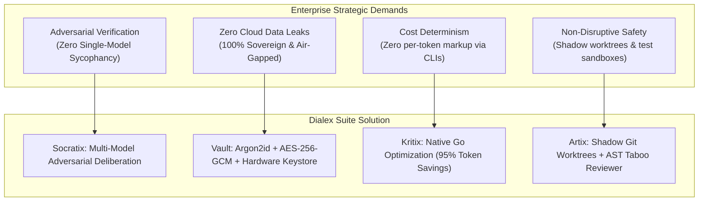
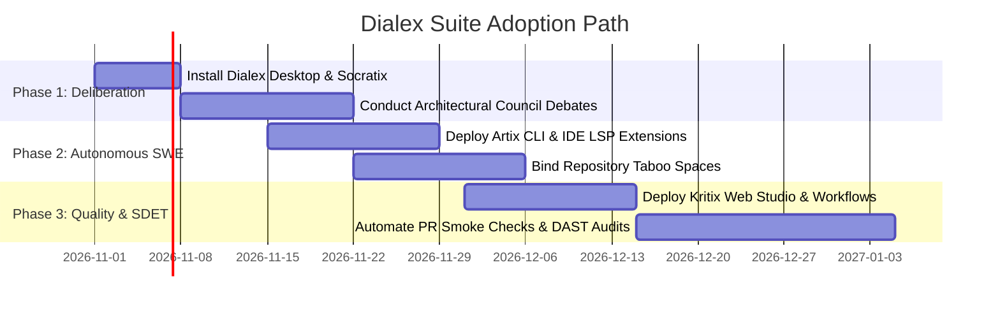

# Dialex Suite: Prospective Users Technical Evaluation Guide

**Author:** Kolta Labs Solutions Architecture  
**Audience:** Prospective Enterprise Users, VP of Engineering, CTOs, Lead Architects  
**Scope:** Comparative matrix, technical trade-offs, deployment models, economic ROI, and architectural evaluation criteria.

---

## 1. Why Prospective Users Choose Dialex Suite

Modern enterprise engineering organizations face three compounding crises when adopting AI:
1. **The Solo Sycophant Problem**: General-purpose coding assistants (Copilot, Cursor) operate as a single LLM instance. When given complex architectural trade-offs, they produce plausible-looking code that often silently violates clean architecture boundaries or leaks state.
2. **Runaway Per-Token SaaS Invoicing**: Automated agents that dump whole codebases and raw HTML DOMs into LLM context windows incur astronomical token bills ($10 to $50 per test suite run).
3. **Loss of Intellectual Property & Data Sovereignty**: Cloud-hosted autonomous tools require sending proprietary source code, internal design docs, and company credentials to third-party SaaS servers.



---

## 2. Comprehensive Comparative Matrix

| Feature / Dimension | Dialex Suite | Cursor / GitHub Copilot | Devin / Cognition AI | Playwright / Cypress AI | SonarQube / Snyk |
|---|---|---|---|---|---|
| **Deliberation Architecture** | **Hegelian Multi-Model Council** (Claude + GPT + Gemini debate under moderator) | Single model prompt-response | Single agent planning loop | None | Static rules only |
| **Autonomous Coding Safety** | **Shadow Git Worktrees** (Active branch is never touched until tests pass 100%) | In-place editor edits (dirties working tree) | Remote cloud VM (black box) | N/A | Static alerts (no auto-heal) |
| **Negative Invariant Enforcement** | **Taboo Spaces** (Hard AST and heuristic compile gates) | Soft prompt rules (frequently ignored by LLMs) | Soft prompt instructions | None | Rule violations (post-commit) |
| **Token Cost Model** | **$0 extra billing via Developer CLIs** or local Ollama; 95% DOM compression | Monthly seat license + per-token cloud bill | $500–$5,000/mo enterprise SaaS fee | Per-run cloud billing | Fixed seat licensing |
| **Data Sovereignty** | **100% Sovereign**: Runs on localhost, air-gapped on-premise, or private Tailnet | Code snippets sent to Microsoft/OpenAI | Entire repos cloned into vendor cloud | Web apps crawled via vendor cloud | Local or private cloud server |
| **Testing & SDET Automation** | **Self-healing locators** (Strict/Advisory) + OWASP DAST + k6 perf + Flaky quarantine SLA | None | Basic test execution | Flaky retry loops with raw DOM dumping | Static code analysis only |
| **Output Deliverables** | **Verified ADRs, Decision Matrices, Executive HTML Memos, Green Patches** | Chat completions / code completions | PR branch | HTML test report | Vulnerability dashboard |

---

## 3. How the Suite is Built: Technical Foundations

For prospective technical evaluators evaluating our stack for long-term maintainability:

```text
┌────────────────────────────────────────────────────────────────────────────────┐
│                       DIALEX SUITE TECHNICAL FOUNDATION                         │
├────────────────────────────────────────────────────────────────────────────────┤
│ 1. Core Daemon Layer: Pure Go 1.27                                             │
│    • Zero CGO dependencies for core daemons; static cross-compilation.        │
│    • Ultra-low memory footprint (< 35 MB idle RSS per daemon).                 │
│    • High-concurrency goroutine state machines with zero channel leaks.        │
│                                                                                │
│ 2. Client Layer: Kotlin Multiplatform (KMP) & Compose Multiplatform 1.10+      │
│    • Single unified business logic in commonMain (Strict Clean Architecture).  │
│    • Compose Desktop on JVM 21 (Skiko / Skia hardware accelerated rendering).  │
│    • Android native target with Biometric Hardware Keystore (TEE/StrongBox).   │
│    • Built on Kolta Engineering Standards (KoltLibs: MVI, AsyncState, Tokens). │
│                                                                                │
│ 3. Security & Sandboxing Layer: Native OS Primitives                           │
│    • macOS: Apple Seatbelt (sandbox-exec) with restricted filesystem profiles. │
│    • Linux: Bubblewrap (bwrap) unshared network namespaces.                    │
│    • Cryptography: Go crypto/cipher (AES-256-GCM), Argon2id, RFC 6238 TOTP.    │
│    • Database: SQLite 3 in Write-Ahead Logging (WAL) mode with busy timeouts.  │
└────────────────────────────────────────────────────────────────────────────────┘
```

---

## 4. Hardware Requirements & Deployment Profiles

### Profile A: Solo Developer Workstation (Lightweight)
- **Minimum Requirements**: 4 CPU Cores, 8 GB RAM, 2 GB Disk space.
- **Components**: `artix` CLI, `dialex` Desktop App, `kritix` Studio.
- **Inference Mode**: Direct Cloud APIs (Anthropic / OpenAI API keys) or Developer CLI seats (`claude`, `codex`, `agy`).
- **Resource Usage**: $< 200\text{ MB}$ total RAM for engine daemons; Skia UI runs at 60 FPS.

### Profile B: Enterprise Air-Gapped Workstation (Sovereign)
- **Minimum Requirements**: Apple Silicon (M2/M3/M4 Max with 64GB+ Unified Memory) or Linux Workstation with NVIDIA RTX 4090 / A6000 (24GB–48GB VRAM).
- **Components**: Socratix Engine + Ollama / vLLM local runners.
- **Models**: Qwen 2.5 Coder 32B (Q4_K_M) + DeepSeek-R1-Distill-Llama-70B.
- **Network**: Completely disconnected from the public Internet (`--offline`).

### Profile C: Centralized Team Server (Self-Hosted Docker / Kubernetes)
- **Minimum Requirements**: 8 CPU Cores, 32 GB RAM, 100 GB NVMe SSD.
- **Components**: `socratix` daemon, `artixd` webhook server, `kritix` server.
- **Network**: Internal corporate VPN or WireGuard Tailnet via `tsnet`.
- **Integrations**: GitHub Enterprise / GitLab self-hosted webhooks, Jira / Linear sync.

---

## 5. Economic ROI & Cost Analysis

### Traditional AI Engineering Cost Breakdown (Per 50-Developer Team)
- **Cloud Token Invoicing**: 50 engineers $\times$ 1.5M tokens/day $\times$ \$5.00/M tokens = **\$11,250 / month**.
- **Test Suite Agent Burning**: 20 CI runs/day $\times$ 5M raw DOM tokens = **\$15,000 / month**.
- **Total Annual Runaway AI Spend**: **\$315,000 / year**.

### With Dialex Suite Deterministic Optimization
1. **Developer CLI Reuse**: Developers authenticate using flat-rate CLI developer subscriptions (`claude`, `codex`, `agy`). Upstream token markup = **\$0**.
2. **Kritix Semantic DOM Pruning**: Compresses HTML DOMs by **95%** prior to model ingestion. A 200,000-token web page is pruned to an 8,000-token semantic accessibility tree.
3. **Deterministic Pre-Execution**: Code linting, regex assertions, TOTP MFA calculations, and AST validation run natively in Go at **0 tokens**.
4. **Estimated Net Annual Savings**: **\$240,000 – \$280,000 / year** (over 80% cost reduction).

---

## 6. Migration & Adoption Roadmap



1. **Week 1–2 (Advisory Phase)**: Use `dialex-ai` for high-stakes technology decisions (e.g. database selection, cloud migration trade-offs). Generate automated ADRs.
2. **Week 3–4 (Autonomous Engineering Phase)**: Install `artix` CLI and LSP extensions in VS Code or IntelliJ. Use `/grill-me` for user story alignment and execute coding tasks in shadow worktrees.
3. **Week 5–6 (Quality Assurance Phase)**: Record user journeys in `kritix studio`, bind Gherkin specs, and enforce PR smoke guards with self-healing locators in CI/CD.

---

*Next: Continue to [Socratix Engine: Conceptual Foundation](../socratix-engine/01_CONCEPTUAL_FOUNDATION.md).*
