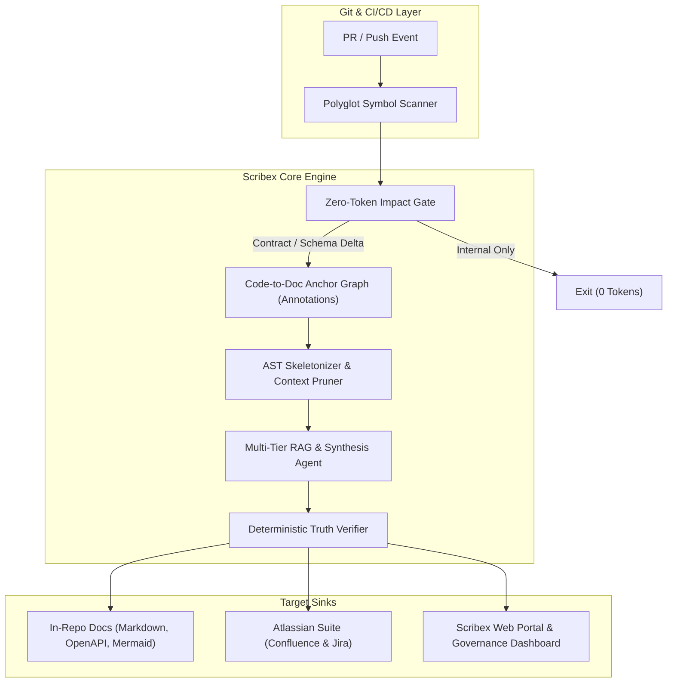

# Spec: Scribex AI — Living Documentation & Code Sync Platform (Dialex Suite, 6th Tool)

Oct 25, 2026 · Dialex Suite Engineering

## 1. Overview & Vision

**Scribex AI** is an intelligent, AST-grounded documentation and knowledge-synchronization platform. It acts as the continuous bridge between code and human documentation, ensuring that technical specifications, API contracts, architecture diagrams, runbooks, and enterprise knowledge bases (Jira, Confluence, Markdown) never rot.

It is the **sixth tool** in the Dialex Suite, joining **Dialex AI**, **Artix AI**, **Kritix AI**, **Socratix Engine**, and **Sentinix AI**.

* **The Problem:** Documentation decay is universal across software engineering. Code changes in PRs daily, but documentation lives scattered across in-repo Markdown, Confluence, Jira, and OpenAPI specs. Updating documentation is manual, tedious, and disconnected from CI gates, turning corporate wikis into "documentation graveyards."
* **The Solution:** A hybrid, AST-grounded engine that monitors git diffs, deterministically maps changed symbols to document anchors, and uses a multi-tier RAG & agentic pipeline to keep code and documentation continuously in sync with zero fluff and minimal token overhead.
* **Dialex Suite Placement:** While Sentinix AI secures the code, Kritix AI reviews code quality, and Artix/Dialex generate and converse, **Scribex AI** maintains the living source of truth and organizational memory.

---

## 2. Target Personas & Multi-Team Value

| Persona | Core Pain Point | Scribex AI Capability |
| :--- | :--- | :--- |
| **Backend / Core Engineers** | API and schema changes drift from READMEs, OpenAPI, and ADRs. | AST diff detection; automated doc patch generation directly into PRs. |
| **Product Managers & Tech Leads** | Jira acceptance criteria drift from actual PR implementation. | Bidirectional Jira-to-PR verification; automated release notes and user story sync. |
| **DevOps / SRE** | Obsolete runbooks, stale environment variables, and out-of-sync Helm/Terraform specs increase MTTR during Sev-1 outages. | Configuration schema tracking; automated `.env.example` and runbook verification gates. |
| **QA & Test Automation** | Test matrices and edge case documentation do not reflect new code branches. | AST-driven edge case detection; test spec updates on interface modifications. |
| **Security & Compliance** | Audit scramble (SOC2, ISO 27001) to prove architecture diagrams and security controls match live code. | Automated traceability matrix: Jira Epic $\leftrightarrow$ PR $\leftrightarrow$ AST Node $\leftrightarrow$ Confluence Architecture Doc. |

---

## 3. Product Principles & Architecture

### 3.1 Non-Negotiables
1. **Deterministic Over Generative**: Deterministic parsing and symbol graph resolution determine *what* changed and *where* docs are anchored. AI is only used to synthesize clear, contextual prose.
2. **Zero-Token Impact Gate**: If a PR only alters internal function implementation without changing public APIs, exported types, config schemas, or contracts, the LLM is **never invoked**.
3. **In-Repo First, Enterprise Extended**: Works natively in git via Markdown, OpenAPI, and Mermaid.js, with first-class enterprise connectors for Confluence and Jira.
4. **Non-Invasive Developer Experience**: Never spams developers. Generates clean companion commits or actionable, consolidated PR review suggestions.

### 3.2 High-Level Architecture



---

## 4. Technical Specifications

### 4.1 AST Grounding & Code-to-Doc Anchors
Scribex links documentation sections to code symbols using non-intrusive HTML/Markdown comments:
```markdown
<!-- @scribex:anchor(pkg/auth/jwt.go#VerifyToken) -->
### VerifyToken
Validates incoming JWT bearer tokens using RS256 algorithm.
<!-- @scribex:end -->
```
For external Confluence pages, Scribex stores page-to-symbol mappings in `.scribex/manifest.yaml`.

### 4.2 Multi-Tier RAG & Token Optimization
* **Tier 1 (Deterministic Graph)**: Constant-time symbol-to-doc lookup; 0 vector search overhead for 70%+ tasks.
* **Tier 2 (AST Skeletons)**: Sends only signatures, types, and comments (~40 tokens) instead of full function bodies (~600 tokens).
* **Tier 3 (Surgical Patches)**: Only outputs git diff patches for the targeted doc section rather than regenerating entire documents.
* **Prompt Caching**: System instructions, repository style guides, and vocabulary stay static in the LLM cache.

### 4.3 Living Architecture Diagrams
* Scribex parses package dependencies, gRPC services, and HTTP routes to maintain auto-rendered **Mermaid.js** diagrams inside repository READMEs.
* Diagrams are regenerated automatically upon merge to the default branch.

---

## 5. Enterprise Integrations (Atlassian Suite)

### 5.1 Confluence Integration
* **Live Sync Blocks**: Custom Confluence macro or Markdown page sync via Atlassian REST API.
* **Draft Revision Workflow**: When public contracts change, Scribex opens a draft revision in Confluence with a direct diff preview for the tech lead to approve.

### 5.2 Jira Integration
* Reads issue keys from PR branch/title (`PROJ-1234`).
* Compares PR semantic changes with Jira Issue Description & Acceptance Criteria.
* Flags scope creep or undeclared API breaking changes directly on the Jira ticket.

---

## 6. Phased Implementation Roadmap

### Phase 1: MVP Core (CLI + In-Repo Sync)
* Polyglot symbol scanner (Go, Kotlin, Java, TypeScript/JS, Python).
* Zero-token impact gate for PR diffs.
* In-repo Markdown anchor sync (`<!-- @scribex:anchor -->`).
* Mermaid sequence and dependency diagram generator.
* CLI (`scribex init`, `scribex check`, `scribex sync`).

### Phase 2: CI/CD & GitHub/GitLab Action
* GitHub Action / GitLab CI runner.
* PR companion commit generation & bot review comments.
* Stale doc scavenger (cron job detecting dead symbols and broken links).

### Phase 3: Enterprise Atlassian Suite & Compliance
* Confluence bi-directional sync (OAuth / API Token).
* Jira acceptance criteria reality-check bot.
* SOC2 / ISO 27001 continuous traceability audit matrix export.

### Phase 4: Web Dashboard & Management Portal
* Centralized dashboard for cross-repo doc health and drift metrics.
* Role-based access control (RBAC) and team ownership maps.
