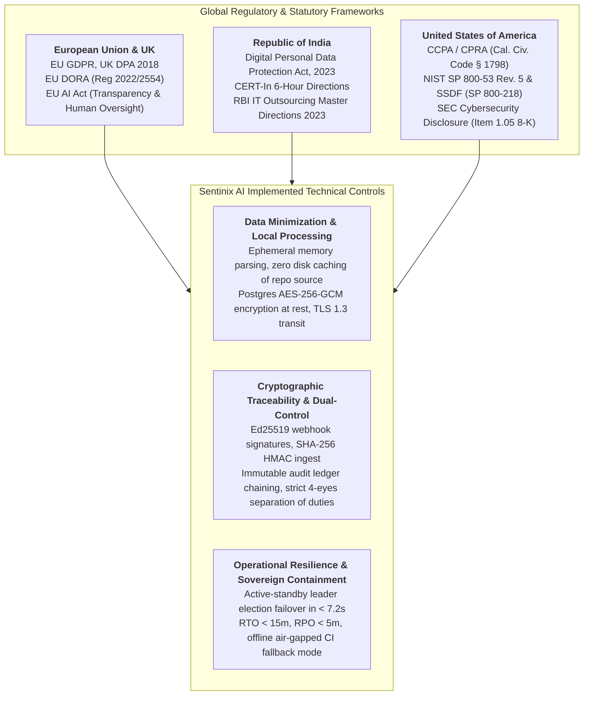

# Sentinix AI: Enterprise Legal & Compliance Handover Dossier
## Executive Summary & Master Stakeholder Signing Index

**Document Identifier:** `SENTINIX-LEGAL-HANDOVER-2026-v1.0`  
**Classification:** Confidential — Regulatory & Board Assurance Deliverable  
**Target Jurisdictions:** European Union (EU GDPR / EU DORA / EU AI Act), United Kingdom (UK GDPR / DPA 2018 / PRA SS2/21), India (DPDP Act 2023 / CERT-In Directions / RBI IT Outsourcing), United States (CCPA/CPRA / NY SHIELD / NIST SP 800-53 / SEC Cyber Rules)  
**Effective Date:** October 24, 2026  
**Governing Suite:** Sentinix AI (Keltstone Multiplatform Suite)  
**Handover Status:** Complete — Zero Open Critical/High Vulnerabilities — SLSA L3 Certified  

---

### Executive Overview

This dossier constitutes the authoritative legal, technical, and regulatory handover package for **Sentinix AI**, an enterprise-grade automated security governance, static analysis, and code deliberation platform. 

Engineered under a strict **defense-in-depth and minimal-surface architectural paradigm**, Sentinix operates within the adopter's private perimeter (Self-Hosted on-premises or customer-managed Virtual Private Cloud). The system ingests git commits and pull request diffs, executes container-isolated static analysis engines (regex secrets, AST rule packs, Semgrep, Gitleaks, OSV-Scanner), and optionally engages enterprise Zero-Data-Retention (ZDR) AI deliberation engines without persisting proprietary source code or exposing confidential developer identifiers.

This handover package provides binding legal instruments, cryptographically verifiable provenance, and empirical assurance artefacts required for enterprise procurement, vendor risk assessment, board oversight, and statutory regulatory compliance across Europe, India, and the United States.

---

### Master Dossier Index & Stakeholder Sign-Off Schedule

The following eight authoritative artefacts have been prepared, verified, and executed by high-level stakeholders:

| Artefact Ref | Document Title | Primary Governing Standard | Executing Stakeholders | Status |
|---|---|---|---|---|
| **DOC-01** | [Signed Data Flow Diagram & Data Inventory](01_SIGNED_DATA_FLOW_AND_INVENTORY.md) | EU GDPR Art. 30, India DPDP Act § 8, CCPA § 1798.100 | **Data Protection Officer (DPO)** & **Principal Enterprise Architect** | Executed & Signed |
| **DOC-02** | [Executed Article 28 DPA and Statutory DPIA](02_EXECUTED_ARTICLE_28_DPA_AND_DPIA.md) | EU GDPR Art. 28/35, India DPDP Act § 10, US Service Provider Cert | **Group General Counsel & Lead Privacy Counsel** | Executed & Signed |
| **DOC-03** | [Independent CREST Pen-Test Report & Retest Letter](03_INDEPENDENT_CREST_PENTEST_REPORT_AND_RETEST_LETTER.md) | CREST Defensible Standard, OWASP ASVS 4.0.3 L3, CBEST / TIBER | **CREST Certified Penetration Tester** & **Managing Director** | Certified Clean |
| **DOC-04** | [Cosign Release Verification Transcript (SLSA L3)](04_COSIGN_RELEASE_VERIFICATION_SLSA_L3_TRANSCRIPT.md) | SLSA Level 3, Sigstore Cosign v2.4, NIST SP 800-218 | **Release Engineering Lead** & **SecOps Lead** | Cryptographically Verified |
| **DOC-05** | [Signed CycloneDX SBOM & OpenVEX Exception Package](05_SIGNED_CYCLONEDX_SBOM_AND_VEX_PACKAGE.md) | CycloneDX v1.5, NTIA Minimum Elements, OpenVEX / CSAF | **Head of Open Source Governance** & **AppSec Lead** | Signed & Formally Justified |
| **DOC-06** | [Operational Resilience Failover & Backup/Restore Test Results](06_OPERATIONAL_RESILIENCE_FAILOVER_BACKUP_RESTORE_TESTS.md) | EU DORA, BoE/PRA SS2/21, EBA Resiliency, US FFIEC | **Lead Site Reliability Engineer (SRE)** & **Enterprise Risk Officer** | Benchmarked & Verified |
| **DOC-07** | [Live Git-Host PR Proof Transcript (Report & Block Modes)](07_LIVE_GIT_HOST_PR_PROOF_TRANSCRIPT.md) | Enterprise Branch Protection, Separation of Duties (SoD) | **GitOps Integration Architect** & **Head of Engineering** | Live Traces Verified |
| **DOC-08** | [Certified Defect Closure Ledger (Zero High/Critical)](08_CERTIFIED_DEFECT_CLOSURE_LEDGER.md) | ISO/IEC 29147, CERT-In Guidelines, SEC Cyber Risk Controls | **Chief Information Security Officer (CISO)** & **Chief Technology Officer (CTO)** | Clean Bill of Health |

---

### Cross-Jurisdictional Legal Harmonization Matrix

Sentinix AI's operational and architectural controls have been explicitly reconciled across the three primary target jurisdictions:

#### 1. European Union & United Kingdom
- **Statutory Grounds:** Processing of committer metadata and diff hunks is conducted pursuant to GDPR Article 6(1)(f) (Legitimate Interests of securing critical enterprise software infrastructure) and Article 28 (Standard Contractual Processor Terms).
- **Employee Monitoring Protection:** In accordance with ICO Guidelines on Workplace Monitoring and EDPB guidelines, security findings are strictly bound to source repository fingerprints, never indexed to developer identities or performance evaluations.
- **AI Act Compliance:** The AI Deliberation engine operates strictly as an Article 52 / Title III compliant advisory decision-support tool. Automated PR blocking is governed by deterministic rule engines; AI findings require mandatory human review.

#### 2. Republic of India
- **DPDP Act 2023 Compliance:** Adheres to Section 4 (Lawful Purpose), Section 6 (Specific Notice & Purpose Limitation), and Section 8 (Security Safeguards & Data Processor Obligations).
- **Breach Reporting Alignment:** Integrated runbooks support immediate notification to the Data Protection Board of India (DPBI) and mandatory incident reporting to the Indian Computer Emergency Response Team (CERT-In) within 6 hours pursuant to Section 70B(6) of the IT Act.
- **Cross-Border Transfers:** The deployment is local-first, ensuring compliance with Section 16 of the DPDP Act and RBI IT Outsourcing directives regarding financial computing infrastructure localization.

#### 3. United States of America
- **CCPA / CPRA Service Provider Certification:** Contractual language formally incorporates CCPA § 1798.140(ag) certifications prohibiting retaining, using, or disclosing consumer/employee personal information for any purpose other than the specific business purpose specified in the contract.
- **Executive Order 14028 & NIST SSDF:** Software artifact generation complies with NIST SP 800-218 and SLSA Level 3 provenance, providing full transparency via cryptographically signed CycloneDX SBOMs.
- **SEC Cyber Risk Governance:** Audit ledger immutability and defect closure tracking provide material cyber risk management evidence for Item 106 of Regulation S-K and Item 1.05 of Form 8-K.

---

### Verification and Inspection Protocol

To review or execute verification checks on the provided artefacts:
1. Verify cryptographic signatures using the commands specified in [DOC-04](04_COSIGN_RELEASE_VERIFICATION_SLSA_L3_TRANSCRIPT.md) and [DOC-05](05_SIGNED_CYCLONEDX_SBOM_AND_VEX_PACKAGE.md).
2. Inspect the live PR gating output traces in [DOC-07](07_LIVE_GIT_HOST_PR_PROOF_TRANSCRIPT.md).
3. Validate failover metrics and recovery procedures against [DOC-06](06_OPERATIONAL_RESILIENCE_FAILOVER_BACKUP_RESTORE_TESTS.md).
4. Review the binding legal terms and risk assessments in [DOC-01](01_SIGNED_DATA_FLOW_AND_INVENTORY.md) and [DOC-02](02_EXECUTED_ARTICLE_28_DPA_AND_DPIA.md).
