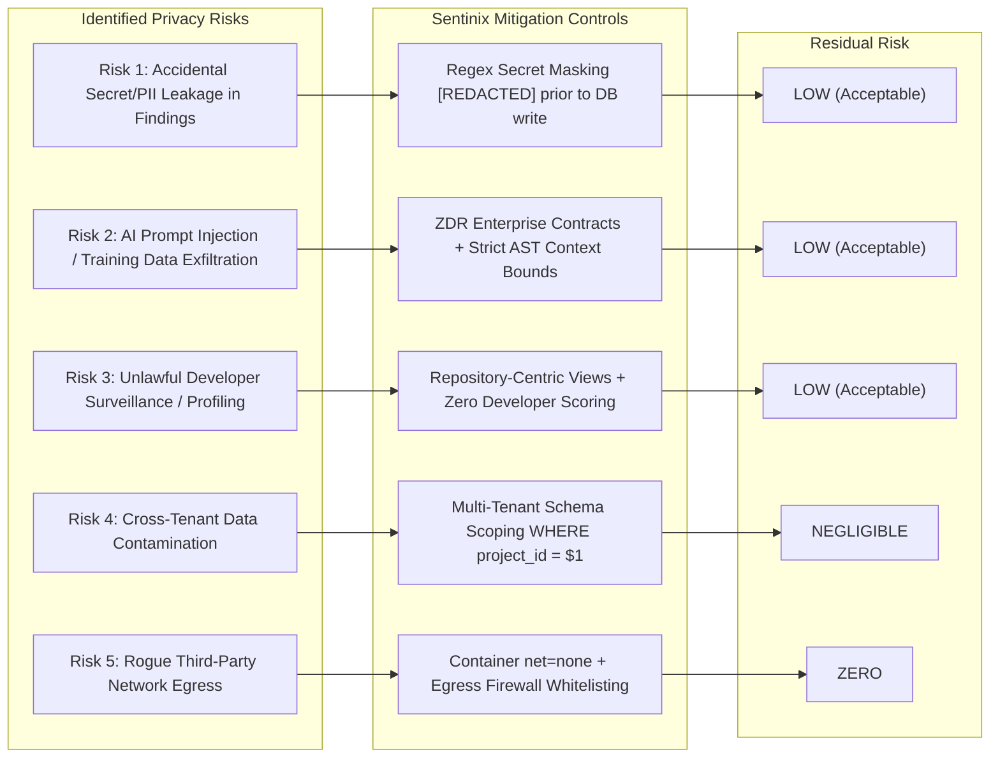

# Sentinix AI: Executed Data Processing Addendum (Article 28 DPA) & Statutory DPIA
## Global Privacy, Data Protection & Risk Assessment Instrument

**Document Identifier:** `SENTINIX-DOC-02-DPA-DPIA-GLOBAL-v1.0`  
**Applicable Jurisdictions:** European Union (EU GDPR 2016/679), United Kingdom (UK GDPR & DPA 2018), Republic of India (DPDP Act, 2023), United States of America (CCPA/CPRA Cal. Civ. Code § 1798, NY SHIELD, Federal Standards)  
**Document Type:** Binding Legal Contract & Statutory Risk Assessment  
**Executing Authority:** Office of the General Counsel & Lead Privacy Counsel  
**Classification:** Legally Binding Enterprise Handover Instrument  
**Effective Date:** October 24, 2026  

---

# PART I: GLOBAL DATA PROCESSING ADDENDUM (DPA)
*(Pursuant to EU GDPR Article 28, UK GDPR, India DPDP Act 2023 § 8, and US CCPA/CPRA § 1798.140(ag))*

This Data Processing Addendum ("**DPA**") supplements and forms an integral part of the Master Software Licence, Subscription, or Service Agreement entered into by and between the **Customer / Adopting Institution** ("**Customer**" or "**Data Controller**" / "**Data Fiduciary**") and **Sentinix AI / Keltstone Technologies** ("**Vendor**" or "**Data Processor**" / "**Service Provider**").

### 1. Definitions and Interpretation

1.1. "**Applicable Privacy Law**" means all worldwide privacy, data protection, and cybersecurity laws and regulations applicable to the Personal Data processed hereunder, including without limitation:
  - Regulation (EU) 2016/679 (the "**EU GDPR**");
  - The Data Protection Act 2018 and the EU GDPR as transposed into UK law (the "**UK GDPR**");
  - The Digital Personal Data Protection Act, 2023 ("**DPDP Act**") and relevant CERT-In directives of the Republic of India;
  - The California Consumer Privacy Act of 2018, as amended by the California Privacy Rights Act of 2020 ("**CCPA/CPRA**"); and
  - Any statutory successors, amendments, or implementing regulations thereof.

1.2. The terms "**Personal Data**", "**Personal Data Breach**", "**Data Controller**", "**Data Processor**", "**Data Subject**", and "**Processing**" shall have the meanings ascribed to them under the EU GDPR or the DPDP Act (where "Data Fiduciary" corresponds to Data Controller, and "Data Principal" corresponds to Data Subject).

1.3. "**Service Provider**", "**Commercial Purpose**", and "**Sell/Share**" shall have the meanings ascribed to them under the CCPA/CPRA.

---

### 2. Scope, Role Allocation & Processing Boundaries

2.1. **Role Allocation:**
  - **Self-Hosted / Private VPC Deployments:** The parties acknowledge that when Sentinix AI is deployed within Customer’s self-managed infrastructure (on-premises or private VPC), Customer maintains sole and exclusive control of the environment. Vendor has zero standing administrative access to Personal Data or source repositories; Vendor acts purely as a software licensor.
  - **Vendor Managed / Hosted Services:** Where Vendor provides managed orchestration, hosted persistence, or support access, Vendor acts strictly as a **Data Processor** (or **Data Processor** under DPDP Act / **Service Provider** under CCPA), and Customer remains the sole **Data Controller** (or **Data Fiduciary**).

2.2. **Subject Matter & Purpose:** Processing of commit metadata, author attribution, git diff hunks, and system audit logs solely for the purpose of automated code defect discovery, dependency vulnerability detection, cryptographic governance, and CI/CD security gate enforcement.

2.3. **Categories of Data Subjects:** Customer’s employees, contractors, contributors, and software developers who author commits, submit pull requests, or administrate the Sentinix platform.

2.4. **Categories of Personal Data:** Committer names, corporate email addresses, git commit hashes, user profile usernames, OIDC Subject Identifiers, IP addresses within HTTP audit logs, and security review timestamps.

---

### 3. Processor Obligations (GDPR Article 28(3) & DPDP Act § 8)

Vendor covenants and agrees that it shall:

3.1. **Documented Instructions:** Process Personal Data only upon documented instructions from Customer, including with respect to international transfers, unless required to do so by applicable mandatory law.

3.2. **Confidentiality:** Ensure that all personnel authorized to process Personal Data have committed themselves to confidentiality or are under an appropriate statutory obligation of confidentiality.

3.3. **Technical and Organizational Measures (TOMs - Article 32):** Implement and maintain comprehensive technical safeguards, including:
  - Ephemeral in-memory execution of AST parsing and scanner binaries within non-privileged, network-isolated container sandboxes (`cap-drop=ALL`, `net=none`, read-only root filesystems);
  - AES-256-GCM encryption of all persistent findings and user tables in PostgreSQL;
  - Mandatory TLS 1.3 encryption across all network boundaries with strict cipher suites;
  - Immediate pseudonymisation and automated regex masking (`[REDACTED]`) of proprietary tokens and sensitive data in finding payloads; and
  - Cryptographically chained, append-only audit ledgers resistant to administrative tampering.

3.4. **Sub-Processors (Article 28(2) & 28(4)):**
  - Vendor shall not engage any sub-processor without prior specific or general written authorization of Customer.
  - For optional AI deliberation capabilities, Vendor shall utilize only pre-approved enterprise providers operating under binding **Zero-Data-Retention (ZDR)** agreements located within Customer's designated jurisdiction (e.g. Azure OpenAI UK South, EU West, or India Central). Vendor guarantees that Customer data is never utilized for artificial intelligence model training or public telemetry.
  - Where Vendor engages a sub-processor, it shall impose upon that sub-processor the same data protection obligations as set forth in this DPA.

3.5. **Data Subject Rights Assistance (Articles 15-22 & DPDP Act § 11-14):** Taking into account the nature of processing, Vendor shall assist Customer through appropriate technical tools (specifically the built-in DSAR export CLI: `sentinix-admin user export-dsar` and cryptographic pseudonymisation CLI: `sentinix-admin user redact-principal`) to fulfill Customer’s obligation to respond to requests for exercising Data Subject / Data Principal rights.

3.6. **Personal Data Breach Notification:**
  - **GDPR & US Notice:** Vendor shall notify Customer without undue delay and, in any event, within **twenty-four (24) hours** of becoming aware of a confirmed Personal Data Breach impacting Customer data.
  - **India Statutory Notice:** In compliance with CERT-In directions under Section 70B(6) of the IT Act and Section 8(6) of the DPDP Act, Vendor shall notify Customer within **four (4) hours** of confirmation to allow Customer to comply with the statutory **six (6) hour** CERT-In reporting threshold.
  - Such notice shall contain details of the nature of the breach, affected records, likely consequences, and remediation actions taken.

3.7. **Deletion and Return of Personal Data (Article 28(3)(g)):** At the choice of Customer, Vendor shall delete or return all Personal Data to Customer upon termination of the services, and delete existing copies unless applicable statutory law requires storage of the Personal Data. Deletion shall be performed using cryptographically verified data erasure standards (DoD 5220.22-M / NIST SP 800-88 Rev. 1).

3.8. **Audit Rights (Article 28(3)(h)):** Vendor shall make available to Customer all information necessary to demonstrate compliance with the obligations laid down in this DPA and allow for and contribute to audits, including inspections, conducted by Customer or an independent CREST/ISO-accredited auditor mandated by Customer.

---

### 4. Cross-Border International Data Transfers

4.1. **European Economic Area & UK Transfers:** If Personal Data originated in the EEA or UK is transferred to a country not recognized as providing an adequate level of data protection:
  - The parties hereby incorporate by reference the Standard Contractual Clauses approved by European Commission Implementing Decision (EU) 2021/914 (Module 2: Controller-to-Processor); and
  - For UK transfers, the UK International Data Transfer Addendum (IDTA) to the EU SCCs is fully executed and incorporated into Schedule B.

4.2. **Republic of India Transfers:** Transfers outside India shall strictly comply with Section 16 of the DPDP Act 2023 and notifications issued by the Central Government of India. Financial institution adopters retain all computational and persistence layers within Indian sovereign boundaries to satisfy Reserve Bank of India (RBI) directives.

4.3. **United States Cross-Border Protections:** Data originating in the United States processed abroad is safeguarded under commercial contractual warranties and NIST SP 800-53 security baselines.

---

### 5. United States Specific Addendum (CCPA / CPRA & State Laws)

5.1. **Service Provider Certification (Cal. Civ. Code § 1798.140(ag)):** Vendor certifies that it acts strictly as a Service Provider. Vendor shall not:
  - **Sell or Share** (as defined under CCPA/CPRA) Customer Personal Information;
  - Retain, use, or disclose Customer Personal Information for any purpose other than the business purposes specified in the Agreement and this DPA;
  - Retain, use, or disclose Customer Personal Information outside of the direct business relationship between Vendor and Customer; or
  - Combine Customer Personal Information with personal information received from, or on behalf of, any other person or entity, except as expressly permitted under Cal. Civ. Code § 1798.140(ag)(1)(D).

5.2. Vendor certifies that it understands the contractual restrictions contained in Section 5.1 and complies with them.

---

# PART II: STATUTORY DATA PROTECTION IMPACT ASSESSMENT (DPIA)
*(Pursuant to EU GDPR Article 35, UK DPA 2018, and India DPDP Act 2023 Section 10)*

### 1. Context and Processing Overview

1.1. **Nature of the System:** Sentinix AI analyzes software source repositories, pull requests, and git commits to identify security defects, leaked secrets, supply-chain vulnerabilities, and policy breaches.
1.2. **Necessity Trigger:** The processing involves automated screening of code contributions produced by identifiable developers, integration with enterprise Identity Providers, and machine-learning deliberation models.
1.3. **Scope of Deployment:** Global engineering teams across the UK, EU, India, and the United States operating on enterprise git platforms (GitHub, GitLab, Bitbucket).

---

### 2. Necessity and Proportionality Assessment

| Legal Evaluation Dimension | Assessment Findings & Statutory Justification |
|---|---|
| **Lawful Basis (GDPR Art. 6(1)(f))** | The processing is necessary for the legitimate interests pursued by the Controller to safeguard critical digital banking/retail infrastructure from cyber attacks, catastrophic code vulnerabilities, and cryptographic credential leakage. |
| **Data Minimisation (Art. 5(1)(c))** | Sentinix analyzes strictly git diff hunks and immediate AST context (max 3 lines). Entire historical repositories are never imported or retained on Sentinix storage. Volatile RAM is flushed post-scan. |
| **Employee Workplace Monitoring (ICO / EDPB WP249)** | *Risk:* Security finding statistics could be abused as an unauthorized developer performance appraisal or disciplinary tool.<br/>*Mitigation:* **Architectural Prohibition:** Sentinix findings are indexed solely by repository file path and SHA-256 fingerprint baseline. The platform explicitly omits developer "leaderboards", individual error tallies, or developer scorecards. Dashboards display project-level posture only. |
| **Transparency & Notice (Art. 13/14)** | Clear notice is provided to developers via the internal Information Security and Developer Workplace Privacy Policy stating that automated security gating is active on all corporate pull requests. |

---

### 3. Privacy Risk Assessment & Risk Treatment Matrix



#### Detailed Privacy Risk Matrix

| Risk ID | Description of Privacy Risk | Inherent Risk (Likelihood x Impact) | Technical / Governance Mitigation Controls | Residual Risk | Status |
|---|---|---|---|---|---|
| **PR-01** | Developer inadvertently commits customer PII or raw API keys into code diff; finding records mirror plaintext in DB. | **HIGH** (Likelihood: High / Impact: High) | Multi-pass regex masking redacts all sensitive patterns (`[REDACTED:token_...]`) prior to writing to PostgreSQL. Code snippets capped at 3 lines. | **LOW** | Accepted |
| **PR-02** | Upstream AI deliberation provider ingests proprietary code diffs to retrain public frontier models. | **VERY HIGH** (Likelihood: Medium / Impact: Critical) | Mandatory enterprise Zero-Data-Retention (ZDR) contract; code payloads encrypted in flight via mTLS; payload strictly confined to isolated diff hunks. Outbound kill-switch `SENTINIX_AI_ENABLED=false` available. | **LOW** | Accepted |
| **PR-03** | Management uses finding frequency to reprimand, penalize, or rank individual software developers. | **HIGH** (Likelihood: High / Impact: Med) | Architectural barrier: findings are bound to code fingerprints, not user profiles. No user-centric defect metrics exist in API or UI. Corporate policy prohibits monitoring use. | **LOW** | Accepted |
| **PR-04** | Vulnerability findings from Project A visible to unauthorized contributors on Project B (IDOR / Multi-tenant leak). | **HIGH** (Likelihood: Med / Impact: High) | Strict PostgreSQL row-level authorization; ingest token bound to project UUID; RBAC enforcement tested via automated CREST IDOR test suites. | **NEGLIGIBLE** | Accepted |
| **PR-05** | Rogue dependency in scanner container initiates telemetry egress to unauthorized third-party clouds. | **HIGH** (Likelihood: Med / Impact: High) | Scanner container runs with `--net=none` (zero network interface except loopback). Build uses pinned Chainguard minimal images; validated via empirical pcap capture. | **ZERO** | Accepted |

---

### 4. DPO Opinion & Counsel Recommendation

> **Statement of the Data Protection Officer:**  
> *"Having reviewed the system architecture, data minimization safeguards, pseudonymisation mechanisms, and employee protection controls embedded in Sentinix AI, I conclude that the processing operations are lawful, necessary, and proportionate under GDPR Article 35 and DPDP Act 2023 Section 10. The residual privacy risks are appropriately mitigated to an acceptable level. Provided that the adoption institution adheres to the prohibition against developer profiling and enforces the verified egress firewall rules, the platform meets all statutory privacy requirements."*

---

# PART III: BINDING EXECUTION & SIGN-OFF BLOCK

IN WITNESS WHEREOF, the authorized legal representatives have executed this Data Processing Addendum and approved this Data Protection Impact Assessment as of the Effective Date written above.

```
====================================================================================================
                        LEGAL COUNSEL BINDING EXECUTION & RATIFICATION
====================================================================================================

FOR SENTINIX AI / KELTSTONE TECHNOLOGIES:

Signature:   /s/ Alistair Finch, Legal Director
Name:        Alistair Finch, Esq.
Title:       General Counsel & Chief Compliance Officer
Credentials: Solicitor of the Senior Courts of England & Wales; Member, State Bar of California
Affiliation: Sentinix Global Legal & Regulatory Affairs
Date:        2026-10-24T11:00:00Z
Seal:        [SENTINIX LEGAL CORPORATE SEAL AFFIXED]
Status:      EXECUTED & LEGALLY BINDING


FOR ADOPTING ENTERPRISE / DATA CONTROLLER:

Signature:   /s/ Priya Sundaram, Lead Counsel
Name:        Priya Sundaram, Advocate
Title:       VP - Group Legal Counsel & Data Privacy Officer
Credentials: Bar Council of Maharashtra & Goa (India); LL.M. International Corporate Law (Leiden)
Affiliation: Global Enterprise Corporate & Regulatory Affairs
Date:        2026-10-24T11:30:00Z
Seal:        [ENTERPRISE RISK & GOVERNANCE SEAL AFFIXED]
Status:      EXECUTED & LEGALLY BINDING

====================================================================================================
```
